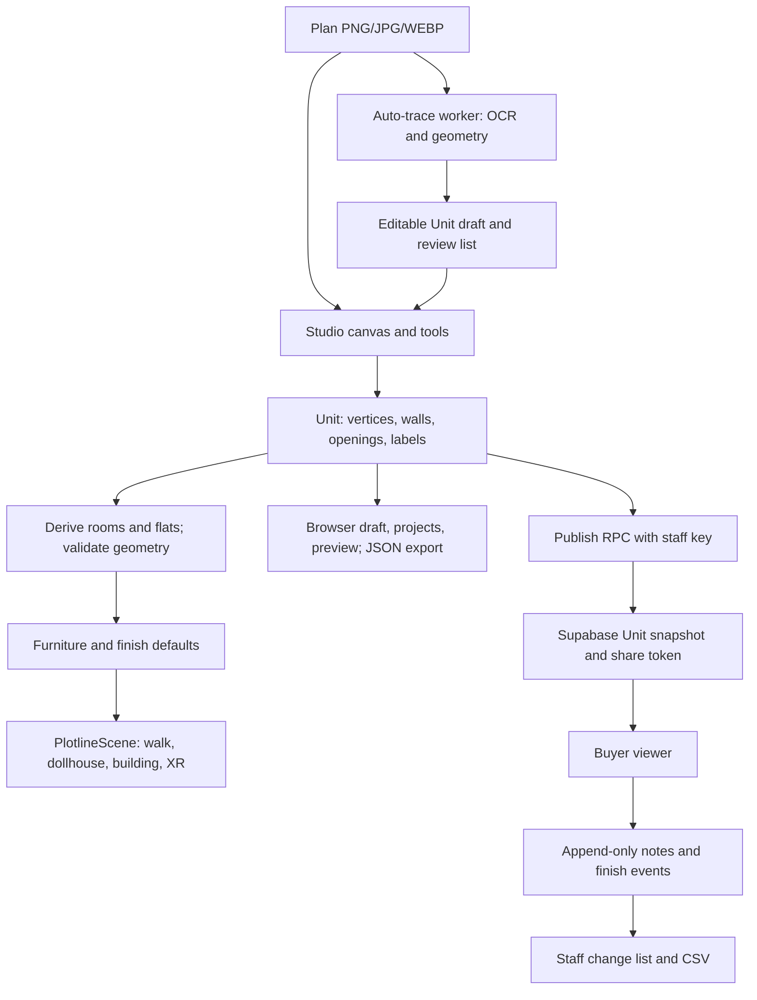

# Context_Plotline

> Project context and onboarding guide for developers and AI coding assistants. Reviewed against this workspace on **13 November 2026 (Asia/Dhaka)**. Read this first, then follow the source links for the area you are changing.
>
> This describes the **current working tree**, including local changes, rather than only the last commit. The inspected checkout was on `main`, based on `c76e4b7`, with existing tracing, rendering, test, script, and documentation changes. Those changes were not committed or deployed as part of writing this guide. Historical results below are explicitly dated; they are not promises about a live deployment.

## Contents

1. [What Plotline is](#1-what-plotline-is)
2. [Product vocabulary and decisions](#2-product-vocabulary-and-decisions)
3. [Get running locally](#3-get-running-locally)
4. [Routes and controls](#4-routes-and-controls)
5. [Repository map](#5-repository-map)
6. [Architecture and data flow](#6-architecture-and-data-flow)
7. [The data contract](#7-the-data-contract)
8. [Geometry and graph rules](#8-geometry-and-graph-rules)
9. [How the Studio works](#9-how-the-studio-works)
10. [How Auto-trace works](#10-how-auto-trace-works)
11. [Furniture, assets, and automatic furnishing](#11-furniture-assets-and-automatic-furnishing)
12. [The 3D engine and viewer](#12-the-3d-engine-and-viewer)
13. [Projects, floors, and building assembly](#13-projects-floors-and-building-assembly)
14. [Location, north, sunlight, and wind](#14-location-north-sunlight-and-wind)
15. [Finishes, configurations, comments, and events](#15-finishes-configurations-comments-and-events)
16. [Where data is saved](#16-where-data-is-saved)
17. [Backend and database](#17-backend-and-database)
18. [Build and deployment](#18-build-and-deployment)
19. [Testing and acceptance](#19-testing-and-acceptance)
20. [Current limitations and unfinished work](#20-current-limitations-and-unfinished-work)
21. [Working on common tasks](#21-working-on-common-tasks)
22. [Instructions for AI assistants and contributors](#22-instructions-for-ai-assistants-and-contributors)
23. [Further reading and keeping this guide current](#23-further-reading-and-keeping-this-guide-current)

## 1. What Plotline is

Plotline is a **digital show flat** for real-estate developers, initially focused on apartment sales in Dhaka. A developer's sales team turns a brochure floor plan into an editable, dimensioned plan and a furnished 3D walkthrough. Buyers open a link, explore the apartment, choose approved finishes, and leave comments anchored to things they see. Staff review those decisions in a shared change list.

The Studio is part of the customer product. A feature is not complete merely because a programmer can produce a good-looking JSON file: a staff member must be able to make and change the same thing through the product.

The intended main workflow is:

1. Create a building project and specify its basements, floors, and rooftop.
2. Load a picture of a whole floor, calibrate its scale, and trace it manually or use Auto-trace.
3. Review walls, openings, room names, sizes, apartment ownership, and uncertain detections.
4. Assign drawings to floors. Reuse a drawing on any chosen floors.
5. Preview the furnished flat or level; inspect the building, daylight, and site context.
6. Adjust furniture and supported plan elements as staff.
7. Publish a unit snapshot and send the buyer its `/s/<token>` link.
8. Review buyer finish choices and object comments at `/changes`; export the change list as CSV.

Product value comes from understanding the actual apartment and recording decisions. Credible dimensions, believable materials, useful sunlight, and usable tracing matter more than matching an offline architectural marketing render. See [PRODUCT_PHILOSOPHY.md](Docs/PRODUCT_PHILOSOPHY.md).

The repository is a substantial prototype with a working local editor/viewer and a small hosted backend. It is not yet a complete account-based, organization-isolated SaaS platform.

## 2. Product vocabulary and decisions

| Term | Meaning in this codebase |
|---|---|
| Unit | The core editable graph document. Despite its name, it can represent one apartment, a whole floor, a basement, a ground floor, or a rooftop. |
| Room | A closed face derived from the wall graph. Its label supplies its name/kind and optional level or slope. |
| Flat / apartment | A derived group of rooms belonging together. Common stair/lift/lobby spaces normally belong to no flat. |
| Floor plan A/B | A reusable **whole-floor drawing**, potentially containing multiple apartments and the shared core. |
| Type A/B, Unit A/B | An apartment name printed on a source sheet. Do not use it interchangeably with a reusable whole-floor drawing. |
| Level | A ground floor, basement, common floor, or rooftop with its own graph, zones, and furnishing rules. |
| Project | Browser-saved drawings plus their building floor assignments. |
| Tower | The runtime building shape consumed by the 3D Building view, produced from a built-in module or a Studio project. |
| Opening | A child of one wall: door, window, sliding door, or open passage. |
| Zone line | A zero-height graph wall that closes a floor/zone face while remaining invisible and non-solid in 3D. |
| Core | Shared circulation/service space such as stair, lift, or lobby; also a directory name for pure geometry/domain logic. |
| Preset | General rules that place furniture according to room kind and geometry. |
| Configuration | Buyer finish-option selections, including group, room, and wall-face overrides. |
| Review / “Check these” | The Studio's live list of uncertainties, geometry issues, size mismatches, and suggested corrections. |
| Share link | Either a viewer configuration URL (`?c=...`) or a published Supabase snapshot (`/s/...`). Their persistence differs. |

Decisions to preserve, distilled from [CLAUDE.md](CLAUDE.md):

- English-only UI for now. Older bilingual interfaces in architectural examples are outdated.
- PC browsers and WebXR headsets are the main realism target. Quality fallbacks exist for weaker machines; old low-end Android budgets are not the current launch gate.
- The operating budget is $0 until revenue; use the existing free/local approach and verified CC0 visual assets. Changes involving paid services need an explicit product decision.
- A wall can stand alone intentionally. A decorative screen or free wall is not automatically an error.
- Levels are data and their appearance comes from general rules. Do not add rendering/furnishing branches for a named project, unit, or room instance.
- Staff can arrange and add furniture in the Studio and viewer. Current manual moves use a **3-inch grid**, not the 1-foot grid mentioned in earlier decisions.
- Manual furniture moves may block doors/passages under the later founder decision. They are refused for being outside their room, overlapping blocking furniture, or covering a window with a wall-mounted piece. Automatic presets still aim to keep circulation clear.
- Staff can edit openings and supported low walls in 3D through the same rules used by the Studio. “Every element is changeable” is approved direction, but remains incomplete; see the manual's element scoreboard.
- A printed room dimension describes its main rectangle. Size checking also considers the whole outline; door nooks and open-plan combinations complicate interpretation.
- Auto-trace can add a non-solid/glazed/low boundary only when evidence and size checks justify it. Remaining uncertainty must stay visible for review.
- A new tracing result must work on the user's real path: load a sheet, click Auto-trace, select a floor/flat, review and export. A result generated only through fixtures or code is insufficient product proof.

## 3. Get running locally

### Toolchain

The root is one npm project, not a monorepo. [package.json](package.json) declares these versions/ranges; [package-lock.json](package-lock.json) is the reproducible installation source.

| Component | Declared version | Role |
|---|---|---|
| React / React DOM | `^19.3.0` | Studio, viewer, and change-list UI |
| TypeScript | `^7.0.2` | Strict type checking |
| Vite | `^8.3.1` | Development server and production bundling |
| Three.js | `^0.186.1` | WebGL rendering, controls, asset loading, WebXR |
| Tesseract.js | `^7.0.0` | Local OCR for Auto-trace |
| Vitest | `^5.0.1` | Node-based automated tests |
| Playwright | `^1.63.0` | Firefox workflow scripts and image decoding |
| IWER | `^2.5.0` | DEV-only emulated XR device |

The root package does not pin Node through `engines` or a runtime-version file. Installed Vite requires Node `^20.19.0 || >=22.12.0`; installed Vitest requires `^22.12.0 || ^24.0.0 || >=26.0.0`. Use a runtime satisfying both. This guide's build was run with **Node 22.22.1**. These are requirements observed in installed package metadata, not a recommendation to upgrade dependencies.

### Local commands

From the repository root:

```bash
npm ci
npm run dev
```

Vite is configured for port `5173`; use the actual URL it prints. Open:

- `http://localhost:5173/u/type-a` for a predictable furnished example.
- `http://localhost:5173/studio` for the editor.
- `/u/sheltech-ground` for a level with outdoor zones, ramps, and varying heights.

Use the same hostname and port consistently. Browser storage on `localhost:5173`, `127.0.0.1:5173`, another port, and production belongs to different origins.

```bash
npm run typecheck
npm test
npm run build
npm run preview
```

| Script | Exact responsibility |
|---|---|
| `dev` | Start Vite. It does not start a database or apply migrations. |
| `typecheck` | `tsc -b` across app/config project references. |
| `test` | `vitest run`, matching `src/**/*.test.ts`, Node environment. |
| `build` | `tsc -b && vite build`; output goes to `dist/`. |
| `preview` | Serve an existing production build locally. |
| `score30` | Explicitly enable the expanded 30-sheet tracing benchmark. Requires its external source images/fixtures. |

There is no root lint/format script, backend-start script, or committed CI workflow. Do not claim those checks ran.

### Optional Supabase configuration

Local viewing/editing does not require Supabase. Remote publication and `/changes` do.

Create a root `.env.local` using an intended development project's **public/publishable** settings:

```dotenv
VITE_SUPABASE_URL=https://YOUR_DEV_PROJECT.supabase.co
VITE_SUPABASE_PUBLISHABLE_KEY=YOUR_PUBLIC_PUBLISHABLE_KEY
```

There is no committed `.env.example`. Environment files are ignored. `VITE_` settings are browser-visible; never put a database password, service-role key, secret API key, or the staff publishing key here. Restart Vite after changing environment settings. A production build captures these values at build time.

Apply the SQL migrations separately to that development database, in order, as described in [§17](#17-backend-and-database). Keep the printed staff key private. No backend was provisioned by creating this guide.

For browser automation, install Playwright's matching Firefox binary when needed:

```bash
npx playwright install firefox
```

System browser dependencies may also be needed on a fresh Linux machine. Optional OCR/AI and site calls have their own network requirements; “no backend required” does not mean every feature is fully offline.

## 4. Routes and controls

[src/main.tsx](src/main.tsx) uses a pathname switch with React `lazy` and `Suspense`. There is no router library. `/studio...` loads Studio, `/changes...` loads the change list, and other paths load Viewer, which resolves its own unit/token route.

| Address / parameter | Current behavior |
|---|---|
| `/` | Replaces the address with the first unit discovered by the eager JSON glob. Do not assume this is Type A; use `/u/type-a` explicitly. |
| `/u/<stem-or-unit-id>` | Resolve a built-in JSON by filename stem or `Unit.id`, then a browser-local project unit by its stem. |
| `/u/preview` | Read `plotline.preview` from this origin's localStorage. |
| `/s/<token>` | Fetch a published Unit snapshot through Supabase. |
| `/studio` | Restore the local draft or start an empty one. |
| `/studio?unit=<stem-or-id>` | Edit a built-in unit as a local Studio draft, with a replacement prompt when applicable. |
| `/changes` | Staff report of published links and buyer events, protected by the shared staff key. |
| `?c=<base64url-json>` | Carry finish selections; the viewer treats this as a buyer/configuration link. |
| `?staff=1` / `?staff=0` | Set/remove the browser's staff UI flag. The parameter is then removed from the address. |
| `?floor=N` | Use a valid floor assignment of that unit's tower. It does not rewrite its source JSON. |
| `?view=dollhouse` / `?view=building` | Enter the requested view after loading. Internally dollhouse mode is called `orbit`. |
| `?pick=N` | Initial selected floor in Building view. |
| `?quality=lite\|low\|high` | Force a quality tier, subject to a GPU-failure fallback. |
| `?ao=0`, `?shadows=0` | Rendering diagnostic switches. |
| `?xr=emulate` | DEV-only IWER headset emulation; exposes `window.__xrDevice` for tooling. |
| `/studio?mock-trace` | DEV-only fixed trace result for editor interaction work. Never use it to establish tracing accuracy. |

Opening Studio marks this browser as staff. This flag reveals local editing tools; it is **not authentication**. Published `/s/` pages restrict staff editing, and generated configuration URLs omit the staff flag.

Essential Studio keys: `V` select, `S` scale, `W` walls, `A` arc, `O` openings, `R` room label, `C` column, `F` furniture. `Ctrl+Z`/redo manage history. Some tools support hold-to-use behavior and modifier keys. Essential viewer keys: `WASD` movement, `O` walk/dollhouse, `B` building, `F` finishes, `C` comment, `P` wind; Escape releases pointer lock or cancels an interaction. Context matters: the same letter can mean something different in Studio or an active editing mode.

Use [Docs/KEYS.md](Docs/KEYS.md) for the full key/button list and [Docs/MANUAL.md](Docs/MANUAL.md) for user instructions. Product UI changes require updating both in the same change.

## 5. Repository map

```text
Plotline/
├── src/
│   ├── main.tsx                 Lazy application entry and pathname dispatch
│   ├── index.css               Shared base styling
│   ├── core/                   Pure domain types, graph, geometry, units, site math
│   ├── studio/                 Editor UI, reducer, snapping, review, workers, local AI
│   ├── trace/                  Raster/OCR/geometry Auto-trace and evaluation utilities
│   ├── dxf/                    ASCII DXF parsing, vector preparation, layer mapping, and Unit graph construction
│   ├── furnish/                Asset metadata, procedural pieces, presets, finish catalog
│   ├── three/                  Three.js scene, rendering, geometry, controls, XR
│   ├── viewer/                 Buyer UI, staff editing glue, configurations, notes
│   ├── lib/                    Supabase RPC and buyer-event transport/reporting
│   └── data/
│       ├── units/              20 hand-authored Unit JSONs
│       ├── building/           Four built-in towers and Studio project model
│       └── fixtures/           Saved regression drafts, site data, small image fixtures
├── public/assets/              Models, PBR textures, HDRIs, art, demo plan images
├── Demo drawings/              Original plan sheets used for development/evaluation
├── supabase/                   SQL setup bundle and two migrations
├── scripts/                    Firefox acceptance, fixture generation, comparison tools
├── Docs/                       Product decisions, manual, tracing reports/evidence
├── docs/developer-guide/       Longer educational walkthroughs by topic
├── audit-reports/              Dated architecture/security/performance findings
├── plotline_1.2/               Archived plain-JavaScript prototype; reference only
├── HANDOFF.md                  Large historical session log, not a current task queue
├── CLAUDE.md                   Invariants and dated founder decisions
├── ARCHITECTURE.md             Earlier architecture proposal; several parts are stale
├── BUILD_PLAN.md               Earlier phased plan; not proof features are implemented
├── graphify-out/               Generated code-index/cache metadata
├── manager/                   Empty in this inspected workspace
├── .trace/                     Ignored local evaluation inputs, caches, and results
├── dist/                       Generated production output, ignored
└── node_modules/               Installed dependencies, ignored
```

`Docs/` and `docs/` are different directories on Linux. Preserve exact filename case. Do not import from `plotline_1.2/` into the current app. It has its own historical state/editor/renderer and documentation, but is not the root Vite application.

## 6. Architecture and data flow



Responsibilities are deliberately split:

- **Core** defines the shared domain contract and pure geometry. It does not know React, DOM, or Three.js.
- **Studio** translates pointer/key/file input into reducer actions in plan metres.
- **Trace** extracts an editable Unit from pixel evidence; it does not create a separate scene representation.
- **Furnish** provides reusable asset metadata, automatic placement, and finish choices.
- **Three** turns that document into visuals and interactions behind a plain class.
- **Viewer** coordinates React panels, scene callbacks, local staff edits, notes, and finish selections.
- **Lib + SQL** handle publication and buyer events; most editor state remains in the browser.

There is no Redux/Zustand store, React Three Fiber, custom Express API, ORM, or Supabase JavaScript SDK. React state/reducers, a plain Three.js scene class, browser storage, and `fetch` are the actual mechanisms. Avoid adding a new framework merely to mirror an existing layer.

## 7. The data contract

The authoritative definitions are [src/core/types.ts](src/core/types.ts), exported through [src/core/index.ts](src/core/index.ts). Architecture-document examples with `projectId`, bilingual names, `facingDeg`, ULIDs, or stored room polygons describe older designs.

### Coordinates and units

- Plan coordinates: `x` right, `y` down, all in metres.
- World coordinates: plan `(x, y)` becomes Three `(X=x, Z=y)`; world `Y` is height.
- Image coordinates: source pixels, converted at the Studio/tracer boundary.
- A wall runs from vertex `a` to `b`. Opening `offsetM` is measured from `a` along that wall to the opening's start, not its centre.
- `northDeg` is clockwise from plan-up (`-y`) toward **true north**. It is not an apartment-facing angle.
- Furniture rotation is clockwise in plan space; the renderer applies its negative as a world-Y rotation. Do not substitute compass rotation logic without checking conventions.
- Money is integer BDT. `areaSqft` is an intentional display/source-plan exception to the metre-based geometry contract.
- New authored IDs normally come from `crypto.randomUUID()` through `newId()`. Built-ins/presets also use stable authored/generated IDs; preserve them across edits.

### Main types

| Type | Essential fields and behavior |
|---|---|
| `Vertex` | `{id, x, y}` in metres. Walls share these IDs at graph junctions. |
| `Wall` | `{id, a, b, thicknessM, heightM, openings, standsAlone?}`. Shared between adjacent faces. |
| `Opening` | `{id, kind, offsetM, widthM, heightM, sillM, hinge?, swing?, curtains?}`. Kinds: `door`, `window`, `passage`, `slider`. |
| `RoomLabel` | `{id, name, kind, x, y, printedSize?, levelM?, slope?, flat?}`. Names a derived face; does not define its polygon. |
| `Room` | Derived `{id, name, kind, loop, wallIds, areaSqm, centroid, joinPts?, ...}`. Label ID becomes room ID when labelled. Never persist this instead of the wall graph. |
| `Pillar` | `{id, x, y, wM, hM, corners?}`. `hM` is plan depth, not vertical height; optional four corners describe a tapered column. |
| `FurniturePlacement` | `{id, assetId, roomId, x, y, rotationDeg, scale?, sizeM?, removed?, openingId?, shiftM?, endsM?}`. |
| `FinishSlot` | Group with target `floor/wall/ceiling`, covered room IDs or `'all'`, options, and default option ID. |
| `FinishOption` | Stable ID, brand, SKU, label, integer `priceDeltaBdt`, and a color/PBR `MaterialRef`. |
| `Unit` | ID/name/projectName, optional floor, north, graph, pillars, labels, furniture, finish slots, area, optional source-image transform and cached site. |
| `Site` | Latitude/longitude, optional UTC offset/fetch time, neighbor footprints, roads, and monthly wind. |
| `Configuration` | Record mapping slot/room/wall-face keys to option IDs. |

Room kinds include apartment rooms (`bed`, `living`, `dining`, `kitchen`, `bath`, `balcony`, `study`, `closet`, `utility`, `shaft`, `other`, `foyer`, `pantry`, `maid`, `prayer`), common rooms (`lobby`, `gym`, `community`, `guard`), and outdoor zones (`lawn`, `paving`, `driveway`, `parking`, `deck`, `pool`, `planter`, `play`). Room kind affects furnishing, ceiling generation, flat membership, and finishes; a new kind is a cross-module change.

### Minimal example

This is a complete small graph document, not a production fixture. The strings stand in for stable authored IDs; generate IDs with `newId()` in product code.

```json
{
  "id": "example-unit",
  "projectName": "Example project",
  "name": "Floor plan A",
  "northDeg": 0,
  "vertices": [
    { "id": "v1", "x": 0, "y": 0 },
    { "id": "v2", "x": 4, "y": 0 },
    { "id": "v3", "x": 4, "y": 3 },
    { "id": "v4", "x": 0, "y": 3 }
  ],
  "walls": [
    { "id": "w1", "a": "v1", "b": "v2", "thicknessM": 0.127, "heightM": 3.048,
      "openings": [{ "id": "o1", "kind": "door", "offsetM": 0.4, "widthM": 0.9, "heightM": 2.134, "sillM": 0, "hinge": "a", "swing": "in" }] },
    { "id": "w2", "a": "v2", "b": "v3", "thicknessM": 0.127, "heightM": 3.048, "openings": [] },
    { "id": "w3", "a": "v3", "b": "v4", "thicknessM": 0.127, "heightM": 3.048, "openings": [] },
    { "id": "w4", "a": "v4", "b": "v1", "thicknessM": 0.127, "heightM": 3.048, "openings": [] }
  ],
  "roomLabels": [{ "id": "r1", "name": "Bed 1", "kind": "bed", "x": 2, "y": 1.5 }],
  "furniture": [],
  "finishSlots": [],
  "areaSqft": 0
}
```

`deriveRooms(unit)` derives the face; `layoutFor` can supply furniture and viewer defaults can supply area/finish choices. Empty furniture does not mean “show an intentionally empty room”; deletions require tombstones.

## 8. Geometry and graph rules

| File | Responsibility / entry points |
|---|---|
| [core/graph.ts](src/core/graph.ts) | `deriveRooms`, `validate`, touching-wall/column joins, room labels, floor lookup, apartment-stamp recognition. |
| [core/geometry.ts](src/core/geometry.ts) | `wallFrame`, `wallPieces`, room polygons, inner polygons, triangulation, containment, bounds, centroids, dimensions, floor heights. |
| [core/flats.ts](src/core/flats.ts) | `deriveFlats`, `isCore`, `LOW_WALL_M`; room connectivity and ownership overrides. |
| [core/units.ts](src/core/units.ts) | Parse/format feet-and-inches and metric input; `FT`, `sqmToSqft`. Bare numeric length input defaults to feet. |
| [core/mirror.ts](src/core/mirror.ts) | Mirror a Unit, including wall direction/opening offsets and suffixed IDs. |
| [core/site.ts](src/core/site.ts) | Pure sun/site/wind calculations and conversions from fetched data. |

`deriveRooms` constructs directed half-edges, orders them around vertices, traverses bounded faces, and assigns labels to containing faces. It handles arbitrary-angle polygons; do not assume every room is rectangular or aligned to the image axes.

Normal authored joins use shared vertices, with crossings/T-junctions split by the editor. Derivation also makes a temporary joined graph for loose wall ends touching a column or another wall's body. It does not silently rewrite the source Unit. The touching tolerance `TOUCH_M` is `0.0127 m` (half an inch), and derived loops can contain `joinPts` absent from `unit.vertices`; always use `roomPolygon`, not a direct vertex lookup for every loop ID.

Unlabelled face IDs are derived from their loops; a label gives its face a stable label ID. Nested disconnected islands are not automatically subtracted as holes. The validator reports `island-in-room`; a connecting zero-height zone edge can form a valid keyhole boundary.

Validation issue codes include dangling vertices, zero-length/duplicate walls, opening bounds/overlaps, unlabelled faces, labels outside faces, wall intersections, and islands. `standsAlone` makes intentional free ends acceptable. Keep validation and Studio's plain-language issue copy consistent.

Special geometry behavior:

- `heightM === 0`: zone boundary, no visible wall, collision, skirting, or sunlight blocking; no openings.
- Walls around kerb height (up to `0.2 m`) and low walls have distinct rendering/stepping rules.
- A low wall with a real door/window may be raised to accommodate it; passage-only gates can retain their low height. Reuse normalization/reducer rules.
- `RoomLabel.levelM` sets the room's floor datum. `slope` varies it along a direction; walker and rendered floor use the same height calculation.
- A pool label's level represents its water surface. Pool/basin generation has its own depth/drop rules.
- `mainRectangle`, `outlineBox`, and `printedSizeCheck` implement source-plan dimension checks. A mismatch is not a reason to force a real irregular room into a rectangle.

`deriveFlats` groups rooms connected by non-window openings or walls lower than `LOW_WALL_M = 1.2`. Core/outdoor spaces normally stop this grouping. `RoomLabel.flat` explicitly pins a room to a named flat; `''` means no flat; omission allows inference. A printed apartment stamp can name the group and supply its printed area without becoming a room label. Flats themselves are derived, not independently stored polygons.

## 9. How the Studio works

### Files and state

| File | Role |
|---|---|
| [StudioApp.tsx](src/studio/StudioApp.tsx) | Canvas/pointer/keyboard orchestration, file import, autosave, projects, previews, publishing, workers. |
| [model.ts](src/studio/model.ts) | Pure `StudioState`, `Action`, `reducer`, normalization, graph edits, geometry validation helpers, undo/redo. |
| [transform.ts](src/studio/transform.ts) | Screen ↔ image-pixel ↔ plan-metre conversion and two-point image alignment. |
| [snap.ts](src/studio/snap.ts) | Point/move/opening snaps and guide geometry. |
| [draw.ts](src/studio/draw.ts) | 2D image/graph/furniture/selection/handle drawing and hit information. |
| [Panel.tsx](src/studio/Panel.tsx) | Tool options, selected-entity fields, room/level fields, validation and review UI. |
| [FloorList.tsx](src/studio/FloorList.tsx) | Project-first setup, floor slots, drawing creation/assignment. |
| [ProjectPanel.tsx](src/studio/ProjectPanel.tsx) | Building placement, repeated floors, mirrored neighbor, common-level placement. |
| [SitePanel.tsx](src/studio/SitePanel.tsx) | Site fetching/map, true north, neighbor height/removal controls. |
| [review.ts](src/studio/review.ts) | `studioReducer` extends the base reducer with Auto-trace/review actions; live room/size checks and answer logging. |
| [issues.ts](src/studio/issues.ts) | Issue marks, leak detection, proposed fixes, previews, answer/action generation and export metadata. |
| [IssueLayer.tsx](src/studio/IssueLayer.tsx) | Issue markers and interactions over the canvas. |
| [fixes.worker.ts](src/studio/fixes.worker.ts) | Expensive suggested-fix computation off the UI thread, sequenced against stale results. |
| [furniture.ts](src/studio/furniture.ts) | Shared furniture editing rules used by both Studio and viewer. |
| [library.ts](src/studio/library.ts), [LibraryPanel.tsx](src/studio/LibraryPanel.tsx) | Search/group/recent asset listing and placement UI. |
| [pictures.ts](src/studio/pictures.ts) | Per-drawing source pictures in IndexedDB. |
| [localAI.ts](src/studio/localAI.ts) | Optional model assistance for review choices. |

`StudioState` contains the Unit, loaded picture, view transform, active tool, selection, wall chain, undo/redo history, timer, opening defaults, transient messages, and review. Domain edits run through the reducer. Unit history has a cap of 200 states; drags use begin/live/end actions so one gesture is one undo step. View/transient state is not a second source of plan geometry.

Typical drawing/edit path:

```text
pointer/key input
  → screenToM / snapping
  → reducer action (metres)
  → updated Unit
  → deriveRooms / deriveFlats / validation / review
  → canvas redraw + panel updates + autosave
```

Wall actions include chains, typed length/angle, splitting/merging joins, moving ends/faces, thickness, stand-alone marking, low/kerb/zone types, and arcs approximated by straight wall segments. Columns support individual corner/side edits with convexity and minimum-size checks. Openings are placed/slid/resized on their parent wall and cannot overlap or run out of bounds. Room tools edit labels, floor levels, slopes, and flat membership.

### Images, scale, and files

- **Upload design**, Ctrl+O and drop share the Studio file router. A new picture starts the whole-floor worker without a flat pick or a scale inherited from the open drawing. The uploaded picture, graph and review enter history together when the worker returns walls. Users can load a picture manually, or retrace an estimated-scale floor from one measured distance. A missing source picture can be reattached by name.
- Input pictures are **PNG/JPEG/WEBP under 10 MB**. PDF import is not implemented; export a PDF page as an image first.
- The browser regression `TRACE_URL=http://127.0.0.1:4173 node scripts/raster-upload-browser.mjs` runs against a local production preview. It uploads a two-room image through the Studio picker, calibrates a 440-pixel wall to 8 m, exports the draft, and checks undo and redo.
- Image-to-plan mapping is `pixel = originPx + metres × pxPerM`; screen mapping then adds zoom/pan.
- The Scale tool measures two points and uses a typed real length. Scaling/repositioning an existing trace must preserve the relevant coordinate relationship; use reducer/transform helpers.
- `fitSheet` aligns a replacement picture from two point pairs and reports angular disagreement. Same-size project sheets can offer another drawing's scale/position; this is a user choice.
- JSON import uses `isUnit` and `normalizeUnit`. These are compatibility guards, **not a complete schema/security validator**.
- Export downloads `<slug>.plotline.json`, containing the Unit and additional review metadata. It does not package the whole Project or embed every source picture/model. Review metadata is not a required `Unit` field.
- Export can proceed with errors after a prompt. Preview is deliberately usable even when the graph has issues.
- A source-image filename in exported JSON is not an uploaded/public asset. Another browser may need the image separately for editing.

Draft autosave is debounced about 400 ms. The stored draft includes Unit, image, view, timer, review, and active drawing identity; undo history is not the durable project format. A tracing timer tracks active input and pauses idle/hidden work according to reducer rules.

Cross-tab opening/low-wall edits use the Studio draft key and `storage` events. Furniture changes use the shared per-unit layout store. This is targeted synchronization, not general collaborative editing.

## 10. How Auto-trace works

### Entry and contract

[src/trace/index.ts](src/trace/index.ts) exposes `autoTrace`, `prepare`, `preview`, `pick`, and `pickFloor`. [types.ts](src/trace/types.ts) defines raster data, pixel geometry, OCR items, hints, options, results, statistics, and review items.

```ts
// Simplified use; the browser Studio does this through a worker.
const prepared = await prepare(gray, { rgb, pxPerM, onProgress })
const result = await pickFloor(prepared) // or pick(prepared, sourceImagePoint)
// result = { unit, review, stats, rejectedText? }
```

The Studio creates [autotrace.worker.ts](src/studio/autotrace.worker.ts) with a module worker URL. It transfers the plan bitmap to the worker when the browser supports OffscreenCanvas. The worker creates grayscale and RGBA buffers at the original coordinates. Browsers without those APIs use the Studio's canvas and transfer the buffers. Auto-trace accepts plans up to 16 megapixels. OCR prepares crops only when a worker has capacity and uses fewer OCR workers on devices with fewer cores or less reported memory.

Worker messages:

- `prepare` → progress → `ready`: process the source sheet once.
- `hover` → `preview`: show the candidate flat before selection; sequence IDs prevent stale hover updates.
- `pick` or `floor` → `done`: return one selected apartment or the whole-floor draft.
- `error`: report failure. Cancel terminates the worker.

The reducer imports the result as an ordinary editable Unit, retains useful user metadata and the displayed sheet, joins geometry, and sets up review. The solver output alone is not always identical to the post-import Studio result; evaluation must account for this.

### Pipeline and files

| Module | Responsibility |
|---|---|
| [raster.ts](src/trace/raster.ts) | Raster polarity/orientation, thresholding, masks, connected components, distance/skeleton and image preprocessing. |
| [text.ts](src/trace/text.ts) | Tesseract orchestration, glyph/line extraction, name normalization/classification, feet/inch grammar, dimensions/areas, tables, face-local OCR recovery, rejected strips. |
| [sizes.ts](src/trace/sizes.ts) | Size-reading support, font/glyph templates and rendering/matching helpers. |
| [walls.ts](src/trace/walls.ts) | Wall extraction coordination, confidence/contrast rules and opening evidence. |
| [tracks.ts](src/trace/tracks.ts) | Current default wall representation: axis/direction tracks and occupied intervals, thickness classes, gaps, and blocks. |
| [bands.ts](src/trace/bands.ts) | Alternate straight-band extraction; retained older path. |
| [track.ts](src/trace/track.ts) | Thin-line continuation from confirmed wall ends, guarded against tracing furniture. Distinct from `tracks.ts`. |
| [doorEnds.ts](src/trace/doorEnds.ts) | Structural wall-tip/jamb probes supporting door recovery. |
| [hints.ts](src/trace/hints.ts) | Fixture/color/greenery clues, color-fill propagation, north hints. |
| [rooms.ts](src/trace/rooms.ts) | Scale fitting from printed sizes, fitted room rectangles, and edge classification. |
| [merge.ts](src/trace/merge.ts) | Reconcile room fits and track evidence into shared walls/openings. |
| [faces.ts](src/trace/faces.ts) | Recover thin/glazed/other non-thick boundaries needed for closed faces. |
| [close.ts](src/trace/close.ts) | Evidence-backed boundary completion and leftover joins with size/geometry checks. |
| [solve.ts](src/trace/solve.ts) | Full orchestration, scale, graph building/repair, ownership/core selection, labels, draft output, and review. `KNOBS` holds many algorithm controls. |
| [ai.ts](src/trace/ai.ts) | Optional Gemini crop/montage text reader and strict answer parsing. |
| `eval.ts`, `evalio.ts`, `solveEval.ts`, `roomsEval.ts`, `textEval.ts`, `hintsEval.ts`, `eval/score30.ts` | Evaluation, fixtures, overlays, scores; not a source of production ground truth. |

### Room-label and dimension recovery

When the first OCR pass misses a room, the solver gives the reader the room’s polygon in sheet pixels. The reader masks pixels outside the polygon and maps Tesseract’s line bounds back onto the drawing. This lets it place a label inside an L-shaped room even when the room’s geometric center lies outside it. Two adjacent rooms can have the same printed name. The reader checks the text boxes for overlap before treating them as duplicate reads. [OCR implementation](src/trace/text.ts)

The reader preserves sparse ink during contrast adjustment and turns sideways strips upright before retrying a missed name. Spelling correction keeps numeric suffixes such as `-02`. A metric unit printed once can apply to both dimensions. The test image shows **KITCHEN** above **440 x 320 cm**, which should yield 4.4 m by 3.2 m. It is a binary grayscale image and opens in a PGM image viewer. [Metric test image](src/data/fixtures/metric-room.pgm)

With `eng.traineddata` in `.trace/tess`, run `TRACE_TESS=.trace/tess npm test -- src/trace/text.test.ts src/trace/textPasses.test.ts` to exercise the parser and local OCR regressions. On 24 November 2026, the targeted regressions passed. The before-and-after Sheltech Level 2 check matched 29 of 41 reference labels in both runs, with eight exact dimensions and zero misread dimensions. [OCR regression tests](src/trace/textPasses.test.ts)

### DXF input (separate from raster Auto-trace)

The unified upload opens the DXF worker for a dropped or selected DXF. The **Import DXF** button also offers a manual review mode before selecting the file. The browser transfers ASCII `.dxf` files up to 15 MB to `src/studio/dxf.worker.ts`, which parses them with the MIT-licensed `dxf-parser` package. The worker expands nested block inserts within size and recursion limits, keeps model and paper space separate, and reports unsupported entities.

For a single drawing with supported declared units, Studio builds automatically if each layer role is supported by its heuristic score or a confirmed mapping. It opens the result if the graph has closed rooms and no unclosed-boundary or printed-size mismatch flags. Other review rows stay with the imported Unit. Otherwise the dialog offers layout, layer and scale controls. For unitless DXFs, a known real length divided by the highlighted straight wall length gives metres per source unit.

`src/dxf/upload.ts` identifies matching layer conventions by names and entity kinds. Successful manual imports save the confirmed roles in browser-local storage for later files. An exact saved drawing profile takes precedence. When a floor adds or drops layers, individually named layers with matching entity kinds reuse their agreed roles. Changed kinds and conflicting roles trigger review. Numeric layer names are only reused within an exact saved profile. Legacy per-file overrides remain available, and scale is determined separately for each upload.

Each import yields one Plotline Unit, equivalent to a single floor plan. Multi-storey building assembly remains the existing project workflow: import each floor as its own Unit, then add the Units to a project.

`src/dxf/buildUnit.ts` converts CAD linework and curves into the Plotline wall graph. It pairs parallel wall faces to estimate centerlines and thickness, joins short gaps for review, attaches mapped openings, and splits wall intersections into shared vertices. It reads room names and sizes with the text helpers in `src/trace/text.ts`, then derives rooms and flats with the core graph functions.

`src/dxf/studioState.ts` handles DXF import and review actions and delegates standard actions to the Studio reducer. Import replaces the Unit as one undoable edit. Undo across that import also restores the previous image, view, and review. The right panel shows **DXF review** for the imported Unit. Draft autosave stores those rows in `dxfReview`, and Export includes them in the JSON's `review` field.

The builder emits review rows for unclosed/unlabelled faces, scale uncertainty, dimension mismatches, unattached or ambiguous openings, ignored layers, and unsupported entities. This is a draft-producing workflow, not a guarantee that arbitrary CAD drawings yield correct rooms or apartments. CAD conventions vary: map the layers and confirm the scale, inspect the generated graph/review, and edit it in Studio. No real customer DXF corpus was available for accuracy measurement at implementation time; synthetic unit tests verify mechanics only. See [the manual's DXF workflow](Docs/MANUAL.md#dxf-input) and [DXF tests](src/dxf/dxf.test.ts).

To run the dedicated UI acceptance script with a real sample when one is available: `node scripts/dxf-browser.mjs <plan.dxf> <metres-per-unit> [output-dir]`. Optional `DXF_LAYER_ROLES='{"A-WALL":"walls"}'` overrides guessed layers. The script records preview/review screenshots and the exported Unit, then checks Undo/Redo; it does not assert geometric accuracy. Accuracy requires comparing a representative real plan against a trusted hand-traced reference.

Conceptually the current solver:

1. Normalizes the sheet's polarity/orientation; reads labels, sizes, area stamps, and tables.
2. Separates useful wall evidence from text, foliage, furniture/hatches, and color fills.
3. Extracts track-based walls and opening evidence. `tracks` is default; `bands` and `skeleton` remain available in internal options/older tooling.
4. Uses explicit scale when given, otherwise combines printed-size/area evidence with wall-thickness priors. The reported source is `given`, `dims`, `area`, or `thickness`.
5. Fits dimensioned room shapes, merges them with tracks, and repairs justified boundaries. Native-resolution/final-scale probes recover faint doors and off-centre glazing.
6. Builds graph faces, associates labels/hints, distinguishes apartments from shared core, and selects the clicked flat or all floor parts.
7. Rechecks dimensions, missing/unclosed/named rooms, uncertain openings, and scale; returns review rather than hiding unresolved cases.

Image coordinates stay in pixels until the solver emits plan geometry. `AutoTraceStats.printed` and review points are in plan metres; source OCR boxes remain in source pixels. Mixing these is a common cause of wrong markers, ownership tests, and overlays.

### Review and AI assistance

The Studio checks review against the **current** edited Unit. Rows can disappear after a real fix or return after a relevant edit. Suggested answers include proposed action lists and source-image boxes. Changing geometry invalidates stale computed answers. Review export may include `answersPending` when computation is not finished.

There are two separate optional AI paths:

| Path | Purpose | Configuration and limits |
|---|---|---|
| Gemini (`trace/ai.ts`) | Re-read uncertain printed names/sizes as crop montages; no geometry authority. | User-supplied browser key `plotline.geminiKey`; adapter currently names `gemini-2.5-flash`. Source crops leave the browser when enabled. No key is required for normal tracing. |
| Local AI (`studio/localAI.ts`) | Pick among explicit review answers using a crop. | Default `http://localhost:11434`, model `qwen2.5vl:7b`, Ollama `/api/tags` and `/api/chat`. Settings in `plotline.localAI`; no server is bundled. |

Local AI checks local/LAN addresses unless a remote override is set and rejects `-cloud` models. Invalid answers become “not sure”; stale answers are rejected if the plan changed. Some fixes can be applied, but answers that remove an opening are presented for human action. Batch assistance skips categories documented as unreliable. A model's approval must not silently remove the user's uncertainty row.

Local AI help text still includes the founder's Windows `E:\dev\tools\ollama` setup. Configure an appropriate local service on a new machine; those paths are not a dependency of the main app. See [Docs/SOURCES.md](Docs/SOURCES.md) for dated local-model measurements and provider history.

## 11. Furniture, assets, and automatic furnishing

| File | Role |
|---|---|
| [furnish/kit.ts](src/furnish/kit.ts) | Asset contract, categories/object kinds, labels, dimensions, resize limits, combined lookup. |
| [kit.data.ts](src/furnish/kit.data.ts) | Registry data for scanned glTF assets; paths, dimensions, orientation, mount metadata. |
| [procedural.meta.ts](src/furnish/procedural.meta.ts) | Pure metadata/IDs/dimensions for code-built assets, greenery, stairs, planter shapes. |
| [procedural.ts](src/furnish/procedural.ts) | Three.js construction of code-built furniture/details/greenery. |
| [presets.ts](src/furnish/presets.ts) | `furnish`, room layout rules, footprints/collision checks, door clearances, curtains. |
| [textures.ts](src/furnish/textures.ts), [textures.data.ts](src/furnish/textures.data.ts) | PBR texture registry and lookups/repetition sizes. |
| [studio/furniture.ts](src/studio/furniture.ts) | `layoutFor`, `refurnish`, move/place/resize/delete, wall mounting, riders/chairs, library listing. |
| [three/furniture.ts](src/three/furniture.ts) | Load/build actual furniture objects, transforms, mounts, fallbacks and pick metadata. |

`furnish(unit, rooms)` chooses placements from room kind, shape, size, openings, and usable walls. It includes flat rooms and common-level/outdoor kinds, lighting/AC, greenery, and supported stairs/planter features. It must work for a new Studio tracing using the same general rules as a built-in.

`layoutFor` is the common resolution point for the Unit's saved pieces plus presets for rooms with no stored pieces. After plan edits, `refurnish` recomputes unchanged preset rooms while preserving deliberately arranged rooms. Do not make a separate viewer-only placement algorithm.

Deletion stores `removed: true` tombstones. Simply removing the last furniture row can cause presets to repopulate the room. Tombstones must remain in saved layouts/exports and be excluded from drawing, picking, framing, lighting, and contact shadows.

Manual editing uses the same rules in 2D and 3D:

- Three-inch grid (`GRID_M = 0.0762`) plus wall snapping, including wall-mounted placement.
- Room containment uses the room's inner polygon.
- Overlap depends on vertical/layer rules: rugs, furniture, wall pieces, and ceiling pieces are not all mutually blocking.
- A TV/decor resting on a piece can move with its supporting piece; dining chairs can follow a table.
- Invalid drops retain the candidate in hand with a visible reason; only valid drops commit.
- `sizeM` overrides dimensions; some procedural pieces rebuild at that size, adding doors/shelves/chairs rather than stretching details.
- Current `resizeLimits` also permits bounded scaling for many scanned assets. Older comments saying scans are never resized are stale. Respect locked proportions and per-asset limits; structure such as stairs and fitted planter beds has restrictions.

Curtains are furniture linked by `openingId`. General hanging rules derive their width/height/position from the opening, then apply staff side reach/shift overrides (`endsM`, `shiftM`). They follow an edited opening and disappear with it. Use the curtain helpers rather than treating them as an independent floor piece.

### Asset workflow

Runtime asset files are under `public/assets/`: glTF manifests/buffers/textures, PBR maps, HDRIs, and art. URLs beginning `/assets/...` are served directly by Vite/static hosting. Assets are committed locally; the viewer does not fetch furniture from Poly Haven's API on every visit.

1. Verify the asset's license and add source/author/license/check date to [public/assets/MANIFEST.md](public/assets/MANIFEST.md).
2. Add files and registry metadata, including real metre dimensions, front axis, mounting, category, and object kind.
3. For a procedural piece, update metadata and builder, then resizing rules where applicable.
4. Expose it through the common library and presets as appropriate.
5. Verify it loads, faces the right way, snaps/resizes correctly, and is selectable in both apps.

Existing assets are mainly Poly Haven/ambientCG CC0 and approximately 1K textures; keep texture budgets sane (project guidance caps at 2K). Source brochure sheets have separate developer ownership; do not infer CC0 rights from their presence beside CC0 assets.

## 12. The 3D engine and viewer

### Scene ownership

[PlotlineScene.ts](src/three/PlotlineScene.ts) is a plain class owning renderer, camera/rig, orbit controls, scene groups, generated geometry, controls, picking, collision, furniture, rendering lifecycle, and XR glue. [ViewerApp.tsx](src/viewer/ViewerApp.tsx) owns UI state and calls it from effects/callbacks.

Useful scene methods include `setUnit`, `setConfiguration`, `setTimeOfDay`, `setLightsMode`, `setWind`, `setMode`, `spawnAt`, `teleportTo`, `showFloor`, `setLayout`, `setArrange`, `setOpeningEdit`, `enableXR`, `resize`, and `dispose`. Changes must clean up listeners, animations, geometries, render targets, and appropriate resources. React StrictMode/HMR can dispose a scene while async loads are still resolving; keep existing stale-load guards.

The renderer applies derived preparation such as raised heads and small-gap dressing to a scene copy. That does not replace graph editing or validation in Studio. Visual closure alone is not proof that the authored graph is correct.

| 3D file | Responsibility |
|---|---|
| [render.ts](src/three/render.ts) | `Look`: tone mapping/postprocessing, HDRI/sky/sun, room lamps, quality settings, slow-frame helpers, covered-zone fixtures. |
| [materials.ts](src/three/materials.ts) | Color/PBR material and texture loading/caching, finish resolution and variants. |
| [details.ts](src/three/details.ts) | Wall solids/opening reveals/casings/skirting, columns, floor/retaining geometry, pool basins, parking markings, steps and solid cover slabs. |
| [openings.ts](src/three/openings.ts) | Door/window/slider hardware and leaf/pane geometry. A slider is an explicit opening kind. |
| [daylight.ts](src/three/daylight.ts) | Per-surface indirect-daylight atlas from apertures/occlusion, neighboring rooms and bounce approximations; shader mapping. |
| [context.ts](src/three/context.ts) | Floor-conforming, room-clipped contact shadows; generated streets/neighbors or cached site context; haze/cutaway shaders. |
| [building.ts](src/three/building.ts) | Stack tower floors, level shells, roofs/cover, exterior picking and floor highlighting. |
| [wind.ts](src/three/wind.ts) | Animated opening/room streamlines using core wind results. |
| [xr.ts](src/three/xr.ts) | Controllers, floor teleport validation, 45° snap turns about the head, room chip, session cleanup. |
| [testUnit.ts](src/three/testUnit.ts) | Small development/test fallback Unit. |

Walls get real holes from wall-local opening dimensions. Room floors are triangulated from graph polygons, respect levels/slopes, and may need retaining faces where adjacent floors differ. Outdoor/shaft/cover rules decide ceilings and roof slabs. Do not close every visible outdoor face with a default ceiling.

The daylight system is a rule-based approximation for believable window-to-interior falloff, not a full physical path tracer. It modifies indirect terms while preserving direct sun/lamp contributions. The scene uses neutral photographic tone mapping; XR renders directly without the desktop AO composer.

### Viewer modules and behavior

| Viewer file | Responsibility |
|---|---|
| [ViewerApp.tsx](src/viewer/ViewerApp.tsx) | Resolve routes/data, instantiate scene, panels, modes, staff editing, events, quality recovery. |
| [defaults.ts](src/viewer/defaults.ts) | General missing-name/area/finish defaults for all loaded Units. |
| [Hud.tsx](src/viewer/Hud.tsx) | Mode buttons, interaction/room hints and staff controls. |
| [Minimap.tsx](src/viewer/Minimap.tsx) | SVG plan/room polygons and location/navigation display. |
| [spawn.ts](src/viewer/spawn.ts), [frame.ts](src/viewer/frame.ts) | Entry placement, room jumps and camera framing from usable geometry/furniture. |
| [FinishesPanel.tsx](src/viewer/FinishesPanel.tsx) | Catalog group/room/wall selection UI and price deltas. |
| [Notes.tsx](src/viewer/Notes.tsx), [storage.ts](src/viewer/storage.ts) | Comment drafting, pins, list and append-only local note storage. |
| [share.ts](src/viewer/share.ts) | Encode/decode safe configurations, share URLs, finish keys and BDT display. |
| [arrange.ts](src/viewer/arrange.ts) | Staff flags, shared layout persistence, held-piece/drop behavior, opening/low-wall edits into the Studio draft. |
| [SunPill.tsx](src/viewer/SunPill.tsx) | Date/time, wind controls, opening chips, wind rose. |
| [quality.ts](src/viewer/quality.ts) | WebGL/device probe, tier recommendation and preference/failure precedence. |
| [ChangeList.tsx](src/viewer/ChangeList.tsx) | Staff report and CSV download. |

Viewer load order matters: resolve and normalize the Unit, apply the requested floor, derive rooms, resolve furniture, and apply defaults. The start screen loads without the 3D engine or scene assets. **Enter** loads the renderer, then reveals the view after the initial furniture, lighting, and finish maps settle. A 20-second limit lets customers enter when an asset stalls. Direct Dollhouse and Building links start the renderer when opened. A saved `plotline.layout.<id>` can override what a built-in JSON appears to contain.

Walk uses graph collision and floor-level/step checks, with pointer-lock, keyboard, and floor-click navigation. Current walk eye height is `1.45 m` and vertical FOV `50°`; dollhouse/building framing differs. Pools are not walkable. Room jumps choose usable camera positions, so room-selection issues may be spawn/framing issues rather than missing meshes.

Staff 3D plan edits run through `studio/model.ts`. `draftState`/`saveOpenings` compare unit identity and the earlier graph against the stored draft to avoid overwriting an independently changed plan. A built-in may first become a draft. Treat these return states and save failures explicitly.

### Quality and XR

| Tier | Main behavior |
|---|---|
| High | AO/postprocessing, larger shadow map and higher sampling/pixel budget. |
| Low | Less expensive rendering, no AO, lower shadows. |
| Lite | Lower pixel, texture and anisotropy budgets, the same surface map types, no scanned plants, and a frame when something changes. |

Priority is session GPU fallback → query tier → explicit browser choice → device recommendation. A slow-frame downgrade is separate from a user's explicit choice. GPU failure can force Lite/reload or a non-3D fallback with a plan and explanation. A canvas existing does not prove rendering is visually correct.

WebXR requires a supported browser/device and secure context. A DEV IWER session is useful for logic tests but does not establish physical-headset acceptance. Test controller teleport, head-centred snap turning, start/end, and desktop recovery when changing XR behavior. Project browser acceptance convention is Firefox; avoid historical Edge/SwiftShader runs that caused excessive CPU load.

## 13. Projects, floors, and building assembly

Authoritative code: [src/data/building/projects.ts](src/data/building/projects.ts) and [index.ts](src/data/building/index.ts).

`Project` stores:

- `id`, `name`, and optional `plan: {basements, floors, rooftop}`.
- `units: Record<Id, Unit>`: drawings, including unassigned drawings in project-first projects.
- `flats`: placed drawing references, offsets, optional left/right mirror.
- `floors`: ranges `{from, to, flats}`.
- `levels`: ground/basement/common/rooftop references, offset and placement method.

Key helpers: `newProject`, `planOf`, `slotsOf`, `setSlot`, `drawingName`, `parseFloors`, `placeFlat`, `removeFlat`, `placeLevel`, `removeLevel`, `removeDrawing`, `sheetOffset`, `alignColumns`, `syncUnit`, `projectTower`, `readProjects`, and `saveProjects`.

The newer UI assigns a whole-floor drawing to arbitrary floor slots. Legacy flat-by-flat placement and mirrored-neighbor support still coexist. Do not rewrite one model as the other without preserving older browser projects. `setSlot` splits/recombines floor ranges when one floor changes; a type need not follow an alternating-floor pattern.

Level numbering: ground `0`, basements negative, occupied floors positive, rooftop at `top + 1`. `FLOOR_M` is shared from `demo-tower.ts` (`3.048 + 0.15 m`); the tower stack does not fully model every source building's actual storey heights.

`projectTower` adapts saved projects into the same shape as built-ins: `FLATS`, `FLOORS`, optional `LEVELS`, `GROUND`, `ROOF`, `CORE`, and `FLOOR_M`. Despite its name, `FLATS` can include level/massing references. Role helpers distinguish a furnished flat, walked level, and massing-only stand-in. `coverOf` supplies overhead footprints from higher floors.

Placement uses a shared plan/building frame. Same-sheet drawings can align from image transforms; otherwise column alignment proposes a translation, requiring at least three matched columns, or staff enter an offset. Mirroring changes IDs and opening directions too; use `mirrorUnit`.

### Built-in data

There are 20 Unit JSON files and four tower modules:

| Tower | Files / coverage |
|---|---|
| BTI demo (`demo-tower.ts`) | `type-a`, `type-b`, `type-c`; benchmark apartments. Type A is the familiar 2703 sft demo. Some building context is authored in the tower module. |
| Sheltech (`sheltech-tower.ts`) | `sheltech-a/b`, ground, basements 1/2, common level 1, rooftop. Two traced flats plus walked levels. |
| Banani (`banani-tower.ts`) | Ground, basements 1/2, roof, typical shell. Upper-floor apartment variations are not all modeled as detailed units. |
| DMD (`dmd-tower.ts`) | Ground, basements 1/2, roof, typical shell. The typical floor's three apartments are not fully hand-traced. |

`towerOf` prefers local projects over built-ins. `projectUnit` resolves local stems. Eager JSON globs make new built-in files discoverable by the viewer, but correct building navigation still needs tower mappings and tests.

Local project routes/building membership depend on browser storage. Publishing a Unit snapshot does not serialize the full Project/tower assignment; a different browser may see the unit without the author's local building context.

## 14. Location, north, sunlight, and wind

[core/site.ts](src/core/site.ts) is pure math; [studio/SitePanel.tsx](src/studio/SitePanel.tsx) performs network fetching and user edits.

- Staff set latitude/longitude directly or search an address with Nominatim.
- Map tiles show the location in Studio.
- Overpass fetches OSM building outlines and roads within roughly 250 m. An OSM map API fallback is present; existing source documentation marks it temporary and needing replacement.
- Building height uses an explicit height tag, otherwise floors × 3 m, otherwise a 9 m guess. Staff can type a height or remove a building/road.
- Open-Meteo archive requests daily wind/temperature/humidity for the ten full years before fetching and aggregates monthly values.
- Site data is cached on `Unit.site`. Buyer viewers use the snapshot and do not refetch the map/weather for each visit.
- Studio site updates propagate to drawings of the current project; `northDeg` remains the shared orientation field read by the geometry/rendering logic.

Site frame is metres east/south of the location; conversion rotates into the plan around its anchor using true north. `sunPosition`/`sunAt` calculate date/time/site sun angles (NOAA-style algorithm). No site defaults to Dhaka, not a globally accurate default location. Date and the site's clock/UTC offset matter; do not use the browser's timezone for arbitrary site physics.

The viewer starts with today's date and 15:30 time, then allows a full-day slider. Lights have `auto/on/off` modes; automatic switches on below approximately 5° sun altitude. Site neighbors can shade a flat and participate in visual cutaways.

Monthly wind is an explanatory guide: openings facing the prevailing wind admit it; outward-facing openings allow outflow; nearby tall upwind blocks can shelter them. `WindFlow` draws streamlines/chips/rose from these rules. It is not real-time gust data, CFD, or an engineering ventilation certification.

Network calls can fail independently. Preserve partial results/problem messages and cached data instead of silently fabricating authoritative site measurements. Keep OSM attribution where cached site data is displayed. [Docs/SOURCES.md](Docs/SOURCES.md) records provider/license/free-tier concerns as of its writing; verify current service terms separately before commercial rollout.

## 15. Finishes, configurations, comments, and events

### Finish resolution

[FINISH_CATALOG](src/furnish/finishes.ts) is the default source of groups/options/brands/SKUs/prices. A Unit's own nonempty slots take precedence. Empty slots are populated by room kind; an unneeded group is omitted. `viewer/defaults.ts` also fills a missing name/area using general rules.

Configuration keys are:

```text
<slotId>                       group selection
room:<roomId>:<target>          room floor / walls / ceiling
wall:<wallId>:<roomId>          wall face toward this room
```

Resolution priority is **wall face → room → group → slot default**. `faceWallId` groups a visually straight wall run so selecting a split segment does not unexpectedly paint only a fragment. Use the shared helpers for both rendering and share/event keys.

`encodeConfig` writes base64url JSON into `?c=`. `decodeConfig` drops unknown keys/options. Share URLs preserve relevant floor/configuration, omit staff and unrelated parameters, and do not automatically publish an unpublished local drawing. Finish state is React/URL state, not a fully synchronized server-side buyer session.

The displayed options total sums chosen deltas according to the existing group/override rules; it does not prorate by surface area. Catalog prices and brands are demonstration data, not a live pricing integration. Base unit price is intentionally not shown in the demo.

### Object comments

Pins carry an anchor `{kind, entityId, offset}` and a creation world point. Entity IDs/local offsets identify the object; the world point alone is not the durable identity. Parts can use IDs such as `<placementId>/<part>`. Preserve parent/part naming when changing procedural assets.

Notes are append-only locally: removal appends a tombstone row rather than editing/deleting an existing row. On `/s/<token>`, note/selection actions additionally create server events. Local note display is not a multi-device readback system for all buyer comments.

### Buyer events

[src/lib/events.ts](src/lib/events.ts) defines `BuyerEvent`, selection/comment payloads, browser identity, outbox, reporting, and CSV generation.

- Buyer identity is a random persistent browser ID with an optional typed name; it is not a verified account.
- Event `id` is generated before send so retrying can be idempotent.
- `ref` identifies a note or finish key. A later same-token/kind/ref row supersedes an earlier one on staff read.
- Network/server failures keep queued events for a later flush; 4xx refusals are dropped with a console warning.
- Flush runs on relevant page load, sending, and online events. This is not a service-worker background queue or guaranteed durable delivery.
- `/changes` groups current choices/notes by link and shows historical/superseded rows; CSV includes event details.
- Known catalog option prices are re-resolved in the staff client. Unknown payloads/prices are not backed by complete server validation.

## 16. Where data is saved

Browser persistence is a central architectural boundary. An exported Unit, a local project, and a published snapshot are different things.

| Storage / key | Contents / use |
|---|---|
| localStorage `plotline.studio.draft` | Current Draft: Unit, loaded image, view, timer, review, drawing identity. |
| `plotline.preview` | Unit last sent to `/u/preview`, also updated for supported 3D plan edits. |
| `plotline.projects` | Browser's saved Project list and embedded Unit drawings. |
| `plotline.studio.project` | Active project ID. |
| `plotline.layout.<unitId>` | Arranged furniture layout shared by Studio and viewer. |
| `plotline.pins.<unitId>` | Local note and removal rows. |
| `plotline.staff` | Local staff UI flag; not the database staff credential. |
| `plotline.staffKey` | Remembered publishing/reporting credential. Treat as sensitive. |
| `plotline.buyer` | Browser buyer ID and typed name. |
| `plotline.outbox` | Pending server event rows. |
| `plotline.geminiKey` | Optional browser-stored Gemini credential. |
| `plotline.localAI` | Local/LAN model endpoint and model choice. |
| `plotline.tracker` | Tracing implementation preference/debug setting. |
| `plotline.answers` | Append-only review-answer training/evaluation log; exportable. |
| `plotline.studio.strips` | Rejected OCR strip boxes by source sheet. |
| `plotline.quality`, `.quality.slow`, `.quality.seen` | Quality preference and recommendation history. |
| sessionStorage `plotline.quality.fallback`, `.quality.note` | Per-tab GPU recovery tier/message. |
| `plotline.lights`, `plotline.windRose`, `plotline.hint.furniture` | Viewer preferences/onboarding hint state. |
| IndexedDB database `plotline`, store `pictures` | Per-drawing source `PlanImage`, keyed by drawing ID. |
| Supabase `units`, `share_links`, `events` | Published snapshots, tokens, buyer history. |
| Files downloaded by Export | A Unit plus review metadata, or answer logs/CSV through their own controls. |

Additional small UI preferences can live alongside these; search the relevant feature's source before changing a key.

Consequences:

- Clearing site storage can erase projects, drawings, source pictures, arrangements, notes, pending events, and remembered keys.
- A preview/project URL copied to another machine is not a cloud-saved project.
- A published snapshot does not update when the local draft changes; publish again to create a new link.
- Full/blocked storage is possible. Some helpers warn while others fail softly; do not promise guaranteed persistence.
- Existing data formats have limited normalization rather than a comprehensive versioned migration system. Preserve older drafts and make compatibility changes deliberately.
- Resetting all localStorage is an unsafe first debugging step. Export/preserve the affected data and inspect the relevant key/origin first.

## 17. Backend and database

The hosted backend is **PostgreSQL functions exposed by Supabase PostgREST**, called with plain `fetch`. SQL is the backend application code. There is no application server to start in this repository.

### Setup and schema

Apply these in order to the intended development project:

1. [20261003120000_share_links.sql](supabase/migrations/20261003120000_share_links.sql).
2. [20261004120000_events.sql](supabase/migrations/20261004120000_events.sql).

[supabase/paste-into-sql-editor.sql](supabase/paste-into-sql-editor.sql) bundles setup for the SQL editor. Scripts use `create ... if not exists` / replace functions to support repeat setup, but this is not a complete future schema-migration strategy. SQL application is separate from npm/build/deployment.

| Table | Main columns / role |
|---|---|
| `public.units` | UUID DB row ID, name, `json jsonb` Unit snapshot, timestamp. DB row ID is separate from the embedded `Unit.id`. |
| `public.share_links` | UUID token → `unit_id`, timestamp. |
| `public.events` | Client UUID ID, token FK, kind, ref, buyer, optional name, payload JSONB, server timestamp. |
| `private.config` | Shared staff key, generated once and retained. |

RLS is enabled on public application tables, direct anonymous/authenticated table privileges are revoked, and there are no ordinary public read policies. Access is through narrowly granted `SECURITY DEFINER` functions. Their checks, ownership, search paths, and grants are the actual security boundary.

### RPC contract

Source: [src/lib/supabase.ts](src/lib/supabase.ts), [src/lib/events.ts](src/lib/events.ts), and the migrations.

| RPC | Arguments | Result / rule |
|---|---|---|
| `unit_by_token` | `p_token: uuid` | Linked Unit JSON or null. Possession of token scopes access. |
| `publish_unit` | `p_unit: jsonb`, `p_key: text` | Check staff key; insert new snapshot/link; return token UUID. |
| `add_event` | `p_id`, `p_token`, `p_kind`, `p_ref`, `p_buyer`, `p_name`, `p_payload` | Insert event; duplicate ID does nothing; return event UUID. |
| `events_for_staff` | `p_key: text` | Check staff key; return all links/events newest first, with superseded flags. |

All use POST to `<SUPABASE_URL>/rest/v1/rpc/<function>`, even read operations. `rpc<T>` parses JSON but does not validate its runtime shape. Non-OK responses become `RpcError(status, message)`. `fetchSharedUnit` maps malformed-token 400 to unavailable/null; UI reports unknown/unavailable links.

The current helper sets both `apikey` and `Authorization: Bearer <configured-key>`. Diagnose actual key/header compatibility when requests fail; do not assume a public publishable key and an authenticated-user JWT have identical semantics. Never fix a browser authorization error by substituting a service-role key.

### Publication and event semantics

Studio Share includes its current arranged furniture and creates a new snapshot/link each time. It does not mutate earlier links. View-scoped tokens are unguessable UUID bearer capabilities; the implementation has no cryptographic signed payload, expiry, or revocation endpoint despite older “signed token” design wording.

Events have FK/check constraints, including allowed kinds, bounded ref/buyer/name lengths, and payload size up to 8 KB. An update/delete trigger enforces append-only rows. Supersession is computed by `row_number` over `(token, kind, ref)`, ordered by timestamp and ID; **buyer identity is not part of that partition**. Thus different browsers using one link can supersede the same finish ref under current behavior.

Accounts, organizations, per-user roles, per-tenant isolation, authoritative server pricing, strict kind-specific payload schema validation, quotas/rate limiting, and complete link lifecycle management are unfinished. The staff key grants global access in this schema. Do not present the future org/RLS architecture in `ARCHITECTURE.md` as shipped.

### Verification script

`node scripts/verify-share.mjs` reads `.env.local` and checks the configured remote database. It is not part of `npm test`. With a staff key argument it **permanently publishes a test snapshot and inserts append-only events**. Use an isolated development database and understand those effects before running it. No live SQL/RPC write was needed to author this guide.

## 18. Build and deployment

[vite.config.ts](vite.config.ts) configures React, Node Vitest, port 5173, and a 2000 kB chunk warning threshold. [tsconfig.app.json](tsconfig.app.json) uses strict checks, ES2022, bundler resolution, React JSX, JSON modules, no unused locals/parameters, and no JS emission from TypeScript. Vite emits the browser output.

Vercel can supply `SUPABASE_URL` and `SUPABASE_KEY`; config explicitly maps them into the browser's `VITE_SUPABASE_URL` / `VITE_SUPABASE_PUBLISHABLE_KEY` when both are present. It rejects recognized secret/service-role formats in the alias key. That guard is not a general secret detector and does not inspect every direct `VITE_` setting.

[vercel.json](vercel.json) rewrites SPA paths to `index.html`, except `/assets/` and `/plans/`. Another static host needs equivalent deep-link handling and must serve model/texture/worker paths correctly. A rewrite exception for `/plans/` does not mean a plan-upload backend exists.

Production preparation:

```bash
npm ci
npm run build
npm run preview
```

Verify deep routes, workers/OCR, asset requests, and representative views against the built output. A development-server success is not a production-worker check. `dist/` is generated and should not be edited by hand.

Historical deployment instructions describe Vercel CLI deployment by the founder and a deployment named `plotline-flax.vercel.app`. This guide did not inspect the live site, current Vercel project, Git integration, plan, or environment. A Git push is not evidence of successful deployment. Use the team's confirmed release process; never deploy merely because a local documentation/build task succeeded.

[Docs/SETUP_SUPABASE_ON_VERCEL.md](Docs/SETUP_SUPABASE_ON_VERCEL.md) has the setup walkthrough. [Docs/SOURCES.md](Docs/SOURCES.md) records historical free-tier/commercial-use constraints and temporary service choices. Those operational facts can change; recheck provider terms when making a release decision.

## 19. Testing and acceptance

### Automated checks

Tests are colocated `*.test.ts` files. Vitest uses the **Node** environment, so most checks exercise pure geometry/rules/state, Three.js geometry without a real WebGL context, or mocked transport/storage. Passing them is not browser, shader, physical-XR, or deployed-database acceptance.

```bash
# All normal automated tests
npm test

# Lower concurrency, with a wider per-test timeout
npm test -- --maxWorkers=2 --testTimeout=30000

# Focused examples
npm test -- src/core/geometry.test.ts src/core/graph.test.ts
npm test -- src/studio/studio.test.ts src/studio/levels.test.ts
npm test -- src/trace/tracks.test.ts src/trace/solve.test.ts
npx vitest run src/dxf/dxf.test.ts
npm test -- src/three/details.test.ts src/three/render.test.ts
npm test -- src/viewer/viewer.test.ts src/lib/events.test.ts
```

Coverage areas include units/geometry/graph/flats/mirroring/site, all built-in flat/level families, presets/assets/finishes/greenery, editor operations/touch/room review/projects/furniture/curtains, wall/text/track/room/solver tracing regressions, rendering/daylight/building/XR logic, viewer framing/arrangement/quality/parity, and RPC/event/reporting helpers.

Some real-image/OCR/evaluation suites are conditional and skipped without external data or enabling environment flags. Several older test defaults still name `E:/dev/tmp/...`; the portable scripts do not erase those dependencies. `TRACE_FIXTURES`, `TRACE_RGB`, `TRACE_TEXT`, `TRACE_NEW_TEXT`, `TRACE_TESS`, and other feature-specific overrides exist; check the relevant test before assuming a default. Some directory overrides require a trailing slash.

### Real Studio tracing acceptance

The portable corpus describes **37 workflows on 29 available source images**, including calibration and apartment-pick variants. Prepare fixtures, serve the app, and exercise normal UI controls:

```bash
node scripts/trace-fixtures.mjs --rgb .trace/fixtures
npm run dev -- --host 127.0.0.1
```

In another terminal:

```bash
TRACE_URL=http://127.0.0.1:5173 node scripts/trace-browser.mjs scripts/trace-cases.json .trace/browser
TRACE_BROWSER_DIR=.trace/browser npx vitest run src/trace/acceptance.test.ts
node scripts/check-trace-results.mjs .trace/browser --require-shared --require-source
```

Fixture generation and browser workflows require Firefox installed through Playwright. Measurement requires the prepared fixtures; the acceptance test writes `measurements.json`, which the final checker consumes.

| Script / data | Purpose |
|---|---|
| `trace-fixtures.mjs` | Decode pictures through Firefox into PGM/PPM matching Studio luminance/white transparency; write `availability.json`. |
| `trace-paths.mjs` | Resolve historical Windows source paths using their repository-relative `Demo drawings/` suffix; supports `TRACE_REPO`. |
| `trace-cases.json` | UI workflow inputs, source images, calibration/pick/edit coordinates. |
| `trace-browser.mjs` | Fresh Firefox context per case: upload, scale, trace, screenshot, Export; capture errors/source fingerprint. |
| `trace-source.mjs` | Hash non-test source `.ts/.tsx/.css/.json` files under `src`, including data/evaluation JSON in that tree. |
| `trace-ownership.json` | Apartment/shared-core measurement witnesses; never supplied to production tracing. |
| `trace-boundaries.json`, `trace-boundaries.mjs` | Source-space marked glazing checks and measured coverage/precision. |
| `check-trace-results.mjs` | Validate corpus completeness/current source, shared ownership, click consistency, and boundary samples. |
| `trace-compare.mjs` | Compare two measured output folders and generate a report. |
| `verify-ground.mjs` | Firefox checks/screenshots of the built-in Sheltech ground level. |
| `verify-share.mjs` | Remote backend checks, with persistent write effects when keyed. |

Useful browser harness options: `TRACE_URL` selects the server; final `key,key` CLI argument selects cases; `TRACE_RESUME=1` reuses successful results with matching hashes; `TRACE_EDIT=<case>` checks a normal wall-width edit and Undo; `TRACE_PREVIEW=<case>` checks Walk/Dollhouse. The strict source checker expects the full manifest, so a subset is not a full-corpus pass.

Do not change source during a measured run. The harness rejects changes within a workflow, and the final checker compares exports to the current source. Ensure the server actually serves that checkout/build. Screenshots, room counts, and spot witnesses have limited scope; they are not complete polygon ground truth.

### Expanded 30-sheet scorer

```bash
node scripts/trace-fixtures.mjs --rgb --sheets src/trace/eval/sheets30.json .trace/fixtures
npm run score30
```

The expanded benchmark is separate from the 29 available demo images. Its 30 annotated source images are missing from this checkout. Fixture preparation reports missing inputs; the scorer writes `coverage.json` and fails if requested fixtures are absent. Ordinary `npm test` skips the expensive run and only checks scorer rules. **A passing normal suite is not a passing 30-sheet benchmark.**

For the checked-in sources, run `npm run bench:uploads` with Playwright Firefox installed. The production Studio uploads three floor images at automatic scale and scores their exported drafts against five hand-traced flats. The same command imports a synthetic DXF twice, with an added furniture layer on the second upload. Raster reports and the DXF control are written to `.trace/upload-benchmark/`. The original 30-sheet benchmark retains its own coverage requirements.

The scorer measures printed rooms closed and correctly named, wrong/unnamed/merged/open rooms, core, false rooms, pillar proxies, names read, and runtime. `SCORE30_SHEETS`, `SCORE30_JSON`, `SCORE30_FIXTURES/OUT/TEXT/TESS`, `SCORE30_FRESH`, and browser comparison settings support controlled runs. Follow [AUTOTRACE_SCORER.md](Docs/AUTOTRACE_SCORER.md) rather than silently scoring a smaller dataset as if complete.

### Required product proof by change

| Change | Verify beyond type checking |
|---|---|
| Graph/dimensions/joins | Focused geometry and editor tests, all affected built-ins, arbitrary-angle/column/opening cases. |
| Auto-trace | Source-image regression, ordinary Firefox trace/export, corpus comparisons, calibrated and automatic scale, flat and whole-floor/core cases. |
| DXF input | Parser/extractor mechanics, actual Studio worker and export with a supplied real DXF; compare rooms/walls/sizes against a trusted same-building reference before making accuracy claims. `scripts/dxf-browser.mjs` is the real-file UI workflow. |
| Viewer/rendering | Normal Walk/Dollhouse/Building navigation, matched before/after views, representative flat and common level, relevant quality tiers. |
| Furniture/library | Add/move/resize/delete/undo/reset in Studio and viewer; preset and tombstone/curtain parity. |
| Storage/import/project | Existing draft compatibility, switch/reload/export, full/blocked/corrupt storage behavior and other-tab conflicts. |
| SQL/events | Disposable development DB role/RPC/constraint checks and UI behavior; mocked Node tests alone do not execute migrations. |
| XR | Logic tests plus device/emulator coverage appropriate to the claim; physical-headset proof for hardware claims. |

## 20. Current limitations and unfinished work

### Latest recorded tracing/rendering state

The latest detailed local tracing checkpoint is [AUTOTRACE_P0_REPORT_2026-11-04.md](Docs/AUTOTRACE_P0_REPORT_2026-11-04.md), following three 3 November reports. It records:

- 37 Firefox workflows across 29 source images with one source fingerprint and no page errors.
- Better calibrated Banani room closure and apartment/shared-core assignment; 60 apartment and 15 core witness checks passed across five selected workflows.
- Five hand-traced reference flats retained their room-match counts, with BTI A wall recovery improved.
- Regressions/unresolved cases on several Sheltech/Banani/ground sheets, uncertain names/openings/sizes, and missing expanded benchmark sources.

These are **dated report findings**, not a new exhaustive browser run performed for this guide, and witness success is not complete ownership-polygon accuracy. [GROUND_RENDERING_FIXES_2026-11-03.md](Docs/GROUND_RENDERING_FIXES_2026-11-03.md) records retaining-side, room-level contact-shadow, solid slab, and covered-light fixes with representative Firefox evidence.

Historical HANDOFF figures use different corpora, source versions, and scoring methods. Do not present them as current overall accuracy or compare totals without checking definitions. [AUTOTRACE_STRATEGY.md](Docs/AUTOTRACE_STRATEGY.md) contains updated checkpoint notes above an older proposal; the proposal's “not implemented” text does not describe today's entire pipeline.

### Gaps to understand before extending the system

| Area | Current limitation / implication |
|---|---|
| Accounts/tenancy | One shared staff key; no per-organization backend isolation or complete Auth lifecycle. |
| Persistence/collaboration | Projects/drafts/pictures/arrangements largely local; no shared cloud editing, complete project backup, or general conflict resolution. |
| Share lifecycle | Immutable snapshots with UUID bearer tokens; no implemented expiry/revocation/manage-links interface. |
| Input/schema validation | `isUnit`, project parsing, RPC result casts and event payload validation are incomplete. Malformed nested data can reach consumers. |
| Event delivery | Local outbox is best effort; blocked/full storage and retry behavior need care; no background worker delivery guarantee. |
| Pricing/history | Demonstration catalog; payload validation/server pricing incomplete; current supersession aggregates by link/ref across buyers. |
| Element editing | Several visible surfaces, outdoor finishes, structural/ceiling/step/sky details are not independently editable; manual §11 tracks the gap. |
| Building fidelity | Some upper floors are massing shells; real differing storey heights/variants are simplified; published units do not carry a full local Project. |
| Auto-trace | Partial OCR/closure/ownership accuracy; automatic scale can be unreliable; no unseen-sheet perfection established. |
| Benchmark portability | Expanded sources and older local caches/harnesses absent; some tests still default to Windows paths. |
| Site services | Network/free-provider dependence, guessed neighbor heights, temporary map API fallback, monthly wind approximation. |
| Performance | Large orchestration modules, generated geometry, substantial model/texture downloads, quality-sensitive WebGL behavior; no universal FPS guarantee. |
| Release operations | No committed CI enforcement/complete monitoring or tested disaster recovery demonstrated here. |

The six [audit-reports](audit-reports/COMPLETE_CODEBASE_AUDIT.md) documents dated 2 November provide more detailed candidate issues and a prioritized roadmap, including Unit/event validation, project drawing loss, and outbox reliability. They are historical investigations with stated verification limits. Some tooling/tracing/rendering findings have since changed; reproduce an issue against current code before fixing it or marking it resolved.

## 21. Working on common tasks

### First day

1. Read this guide's product, data-contract, persistence, and acceptance sections; then [CLAUDE.md](CLAUDE.md).
2. Install with the lockfile, build, and run a focused test such as `src/core/units.test.ts`.
3. Open `/u/type-a`, enter Walk, jump rooms, choose a room/wall finish, leave a note, and try Dollhouse/Building.
4. In Studio, draw a small closed room, add a door/label, change a typed dimension, undo, export and preview it.
5. Create a project, assign/reuse a drawing on floors, reload, and identify the browser storage involved.
6. Try a real brochure image with Auto-trace and inspect its review rows. Use a development backend only if your task needs publishing/events.

### Add an editor operation

Define the domain action/rules in `studio/model.ts`, expose controls in Studio/Panel, and update draw/hit/snap helpers as needed. If 3D must offer it, emit an interaction from `PlotlineScene` and route through the same reducer/rules; handle draft conflicts. Cover undo/redo, export/reload, invalid edits, and both coordinate frames. Update manual/keys.

### Diagnose a missing room or wrong flat

Reproduce with the original image, scale, and normal UI; preserve exported Unit and source version. Compare wall evidence → openings/non-wall edges → graph faces → labels → flat ownership. Use `deriveRooms`, source-space overlays, review state, and `deriveFlats` to isolate which layer failed. A missing name, merged room, unclosed face, and incorrect ownership are different failures. Keep annotations confined to evaluation and avoid source-sheet-specific coordinate rules in production.

### Add a room kind or common-level feature

Start at `core/types.ts`; check outdoor/core classification, graph/size review, OCR classification, furnishing, finishes, ceiling/slab/floor generation, collision/spawn, and Studio inputs. Add general data-driven rules and verify a Studio-created example reaches the same result as any authored benchmark.

### Change materials or lighting

Locate catalog/texture data separately from Three material/shader and `Look` logic. Verify wall-face/room/group precedence, neutral daylight, dusk/night lamps, outdoor cover, and relevant quality tiers. Include cleanup of any atlas, render target, or per-layout shadow geometry. Use matched viewpoints for visual comparisons.

### Add a built-in unit or tower

Create a valid Unit JSON with stable IDs/metre geometry, source transform, labels and optional data; derive/validate it. Add tower mappings when relevant, including floors/offsets/levels/massing role. Check source-image rights and assets. Keep appearance in general furnishing/rendering rules; do not make a special-case renderer for the new unit name.

### Change publication or events

Read SQL, transport helper, payload types, and both UI producers/consumers together. Keep existing links and append-only history meaningful. Use a new migration for actual schema evolution and test on a disposable DB. Account for malformed/legacy rows, idempotency, authorization, current ref supersession, and offline queues. A TypeScript interface alone does not validate JSON at a network boundary.

### Debug a missing draft, layout, or picture

Check origin/profile, Unit/project/drawing IDs, saved layout overrides, localStorage keys, IndexedDB `pictures`, and quota errors before changing code. Export/preserve data. If an opening edit is refused, inspect `draftState` and the prior-plan comparison rather than bypassing the protection.

### Debug 3D failure

Inspect browser console, WebGL 2 capability, failed asset requests, quality selection, fallback/session flags, and disposal/async-load lifecycle. A Lite scanned plant is intentionally absent from rendering while remaining in the layout. Unknown/failed furniture can render as a placeholder. Use rendering switches to isolate AO/shadows, but validate the final normal path too.

## 22. Instructions for AI assistants and contributors

Use this as a starting context, then inspect the actual files involved. Preserve these rules:

1. **Graph first.** Vertices/walls/openings are authoritative; derive rooms/flats. Never maintain a competing persisted room polygon or duplicate one wall per room.
2. **Keep coordinate boundaries explicit.** Metres in domain/reducer logic, pixels in extraction/UI, world Y for height, integer BDT for money.
3. **Preserve stable identity.** Replacing IDs casually breaks furniture, notes, configurations, history, and project references.
4. **Use shared rules.** Editor and viewer editing must agree; authored demo data and user traces must use the same general rendering/furnishing features.
5. **Respect newer decisions.** Read dated decisions and current implementation before enforcing an old restriction from `BUILD_PLAN.md`, architectural examples, or early HANDOFF entries.
6. **Plan core changes first.** Understand affected geometry contracts/callers; extend the public core API deliberately and add meaningful geometry regression coverage.
7. **Preserve the working tree.** Inspect status; do not revert unrelated local changes. Feature-branch/small-working-commit conventions are recorded in `CLAUDE.md`; coordinate with the actual task before committing/releasing.
8. **Treat local storage as user data.** Do not clear it or change formats casually. Keep import/normalization/export and older drafts working.
9. **Keep secrets out of code, logs, examples, and browser build variables.** Staff UI flags are not credentials. Database authorization belongs in SQL, not hidden buttons.
10. **Keep uncertainty visible.** Do not remove warnings, lower thresholds, use oracle text, or import a hand-authored Unit to manufacture an Auto-trace pass.
11. **Report evidence precisely.** Distinguish pure tests, Firefox UI acceptance, screenshot inspection, spot witnesses, full benchmark coverage, live backend checks, and deployment. State skipped/missing coverage.
12. **Maintain user docs.** Update `Docs/MANUAL.md` and `Docs/KEYS.md` with button/key/page changes. Record relevant new source/license decisions and keep this guide current when architecture changes.
13. **Keep the archived prototype separate.** No imports from `plotline_1.2/`; no duplicate architecture because its old README describes a dashboard.
14. **Avoid speculative rewrites.** Fix the affected behavior through existing layers before introducing a router/store/backend/editor framework or unrelated refactor.

A useful task handoff states the reproduced problem, changed behavior/files, data/compatibility effects, checks actually run, remaining limitations, and whether anything was committed or deployed. Historical HANDOFF tasks are context, not automatic permission to execute old commands or deploy.

## 23. Further reading and keeping this guide current

When making a major change in Maheer’s work, update both handoffs in the same change. Record the behavior, workflow and verification here. Record Maheer’s contribution and the affected file paths in the team handoff. [Maheer’s contributions and file ownership](MAHEER_CONTRIBUTIONS.md)

| Read | Why / caveat |
|---|---|
| [README.md](README.md) | Short orientation and scripts. Its “demo root unit” description is less precise than the current glob behavior. |
| [CLAUDE.md](CLAUDE.md) | Founder decisions, invariants, working conventions; newer dated decisions override older limits. |
| [MANUAL.md](Docs/MANUAL.md), [KEYS.md](Docs/KEYS.md) | Detailed human-facing instructions and current element/editing scoreboard. |
| [PRODUCT_PHILOSOPHY.md](Docs/PRODUCT_PHILOSOPHY.md) | Customer problem, positioning, and credible-realism tradeoffs. |
| [PRODUCT_SPEC.md](Docs/PRODUCT_SPEC.md), [masterplan](Docs/Plotline%20masterplan%20v2.md) | Intent and earlier acceptance targets; reconcile with current code. |
| [ARCHITECTURE.md](ARCHITECTURE.md), [BUILD_PLAN.md](BUILD_PLAN.md) | Historical architectural/phasing context, with obsolete schemas/budgets/scope. |
| [HANDOFF.md](HANDOFF.md) | Detailed implementation history, reasons for decisions, external evidence paths; many Windows paths and next-task notes are historical. |
| [AUTOTRACE_STRATEGY.md](Docs/AUTOTRACE_STRATEGY.md), [AUTOTRACE_100.md](Docs/AUTOTRACE_100.md) | Tracing rationale, targets, and historical experiments. |
| [AUTOTRACE_SCORER.md](Docs/AUTOTRACE_SCORER.md), [AUTOTRACE_SCOREBOARD.md](Docs/AUTOTRACE_SCOREBOARD.md) | Measurement definitions and reported corpus results. |
| [P0 tracing report](Docs/AUTOTRACE_P0_REPORT_2026-11-04.md) | Latest detailed local tracing changes/evidence and explicit regressions. |
| [Ground rendering report](Docs/GROUND_RENDERING_FIXES_2026-11-03.md) | Recent rendering fixes and representative visual verification. |
| [SOURCES.md](Docs/SOURCES.md), [asset manifest](public/assets/MANIFEST.md) | Data/assets/providers, license history, temporary service choices; reverify current commercial terms separately. |
| [Supabase/Vercel setup](Docs/SETUP_SUPABASE_ON_VERCEL.md) | Hosted setup walkthrough; never copy real credentials into this guide. |
| [Developer guide](docs/developer-guide/01-TECHNOLOGY-STACK.md) | Twelve longer guides covering stack, architecture, tools, frontend, backend, database, Ubuntu, Git, testing/debugging, deployment, learning, and exercises. Some historical verification limits predate installed dependencies. |
| [Audit](audit-reports/COMPLETE_CODEBASE_AUDIT.md), [issue tracker](audit-reports/ISSUE_TRACKER.md), [fix roadmap](audit-reports/FIX_PRIORITY_ROADMAP.md) | Dated risk investigations; reproduce against current code, not a permanent assertion all findings remain unchanged. |

**Documentation precedence:** use the current task's instructions and latest confirmed product decisions for intent; use executable code/schema plus actual verification for implemented behavior. Where they disagree, record the gap instead of silently converting a roadmap item into a shipped guarantee.

Update this document when routes, core types, state/persistence formats, project assembly, tracing stages, asset rules, database/RPCs, environment names, setup scripts, or acceptance requirements change. Keep dates and scope on measured results. Do not turn historical numbers into a timeless project status.

### Verification performed while creating this guide

- Repository/source/config/schema/doc inventory and cross-checks were performed without changing application source or existing local work.
- `npm run build` passed on Node 22.22.1, including TypeScript checking and production worker/app bundling.
- `npm test -- --maxWorkers=2 --testTimeout=30000` passed: **66 test files passed, 3 skipped; 1,304 tests passed, 27 skipped, 1 todo**, in about 66 seconds. Conditional benchmark/OCR/browser coverage remains subject to the limits above.
- All 158 internal file/section links resolved; the example JSON parsed and Markdown code fences were balanced.
- No fresh full Firefox tracing corpus, physical VR session, live Supabase verification/migration, cloud AI call, or deployment was performed for this documentation change.

### DXF import addition (2026-11-18)

- `npm run typecheck` and `npm run build` passed. `npm test -- --maxWorkers=2 --testTimeout=30000` passed: **67 test files passed, 3 skipped; 1,310 tests passed, 27 skipped, 1 todo**. The six DXF parser/geometry/builder tests passed.
- Firefox Studio smoke test used a temporary synthetic rectangle DXF to exercise file selection, layer mapping, scale, build/review, import/export and Undo/Redo. It established workflow wiring only, not accuracy. The real-file harness is [scripts/dxf-browser.mjs](scripts/dxf-browser.mjs). No architect/customer DXF sample or trusted same-building reference was supplied, so DXF accuracy and block/layer conventions remain unmeasured.
- The fresh Firefox raster corpus produced **37/37 exports** at source hash `2d474f68f52f70f24818d521bbdd1a9e776fe54a75c745b3b7af17f7056dfb75`, with no page errors. Existing acceptance checks passed: 60 flat ownership witnesses, 15 shared-core witnesses, and 736/736 glazing samples in each of two boundary checks. Compared with `.trace/p0/after`, all 37 cases retained the same room, label, opening, validation-issue and review-row counts. Wall endpoints/thickness match within 1 px except for two cases (`sheltech-l2`, `sheltech-l2-a`), where one wall is split into two segments at the same junction (+1 wall); matched wall endpoints differ by at most 0.004 px. See ignored local evidence under `.trace/dxf-raster-comparison/`.
- `npm audit --omit=dev` reported zero production dependency vulnerabilities. Full `npm audit` reported seven vulnerabilities in the existing development toolchain (1 moderate, 6 high); no `npm audit fix` was applied.
- No real DXF accuracy claim, live backend test, commit, push, or deployment was made.

### DXF isolation follow-up

- The first DXF version made the top bar wrap at the browser test viewport. This moved the plan canvas and changed the scale set by the test clicks. **Import DXF** now sits in the right panel. All eight calibrated Firefox cases matched the pre-DXF baseline for image alignment, scale, wall geometry, opening geometry, and room labels.
- Firefox verified that canceling DXF import preserves the open draft. Undo after import restored the previous raster drawing, image, scale, view, and review. Redo restored the DXF drawing and review. After reload, the DXF review was still present, and loading a raster image made Auto-trace available again.
