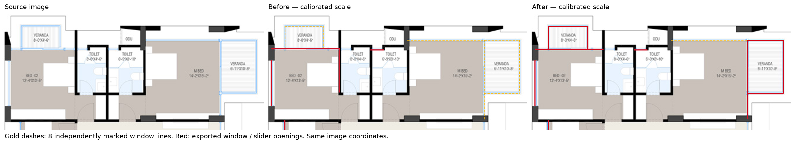

# Glazing and connection tracing improvement — 2026-11-03

Auto-trace now recovers pale blue window fronts that disappeared against darker floor fills, and preserves valid
corner/T connections when a nearby dangling fragment is removed. A further fallback fix prevents a larger unnamed
closed region from displacing an apartment whose bedroom name was read. **This improves a draft; it does not make
tracing complete or establish an overall accuracy percentage.**

This checkpoint starts from the earlier [short-wall contrast fix](AUTOTRACE_REPORT_2026-11-03.md). Its before/after
numbers below measure this additional change, rather than counting the earlier gain again.

## Causes and changes

1. **Colour evidence was lost at room-boundary repair.** The existing `glassMask` finds thin blue/cyan glazing and
   removes broad blue floor fills, but the thin-face pass only examined grayscale pixels. On Banani, a pane can be
   lighter than both the grayscale cut and the dark floor. The grayscale mask absorbs the pane into a large floor
   region, so it is never read as a line. `solve.ts` now supplies that existing colour mask to `thinFaces`.
2. **One continuous pane could be read as fragments.** JPEG and antialiasing shift the coloured core by a pixel.
   A one-pixel halo allows the existing axis-line reader to recover the continuous line. Wall, green and furniture
   exclusions still apply. Overlapping gray readings inherit the positive colour classification so the same pane
   cannot reappear as an opaque low wall after a T junction is split.
3. **Pruning could destroy a valid junction.** An endpoint attached to the nearest short gray fragment. When that
   dangling fragment or duplicate was removed, pruning deleted the complete pane too, even though a surviving
   perpendicular line reached its end. The pass now retries attachment to surviving final spans, using the original
   attachment tolerances.
4. **The no-seed fallback could discard the apartment.** When no usable flat/living/kitchen seed is read, selection
   used only the largest connected region. Closing a large unnamed core on Banani L8 caused the previously retained
   southwest apartment to disappear. Selection now prefers regions containing printed bedroom names already used by the selector, with area
   breaking ties. Stamps and numerals alone do not change common-floor selection. A broader name preference was
   rejected after it displaced the Sheltech ground-floor draft; a new negative test covers that case. The actual
   browser rerun preserves L8's four existing rooms.

Colour-backed lines still need wall attachments, a valid closed face, sensible area/width, supporting real walls,
fixture/furniture checks and fitted-room compatibility. Positive coloured glazing can close a room whose name was
missed, including one larger than the old 4 m² unnamed-AOD limit; such a face still needs at least 40% real-wall rim
and the existing 40 m² maximum. Generic gray frame inference does not receive that exception. Review rows and the
printed-size rejection gate remain active. No project name, image coordinate, hand-traced room or expected annotation
is used in production tracing. `src/core` and the wall/opening geometry contract are unchanged.

## Independent source-image measurement

Eight blue glazing centre lines were marked from two source-image crops on Banani L2–6, independently of the tracer's
output. `scripts/trace-boundaries.json` stores them; it is an evaluation input only. The annotations never enter the
app, OCR or tracing. Source coordinates are the original 1000 × 771 image pixels.

The scorer samples each expected line at approximately one-pixel intervals. A match requires an exported window or
slider centre line within **3 pixels and 5 degrees**. Precision samples predicted window/slider lengths only inside
the two explicitly annotated patches. This measures geometry and glazing classification in those patches; it does
not certify window height/sill, all windows, walls, room topology or the rest of the floor.

| Same workflow and scale before/after | Expected window-line coverage | Precision in annotated patches |
|---|---:|---:|
| S tool: Bed 03 depth 12′, 28.4795 px/m | 15.6% → **82.6%** (115 → 608 / 736 samples) | 92.9% → 100% |
| Automatic: thickness estimate, 33.4646 px/m | 0% → **62.1%** (0 → 457 / 736 samples) | No predicted samples → 98.5% |



Seven of the eight marked lines are now covered completely at the manually set scale. The master-bedroom's north
front remains mostly missing: only the veranda portion of that shared line is retained. That failure is visible in
the figure and included in the denominator. Automatic scale is still wrong on this sheet; setting scale from a
printed dimension materially improves the result.

After Studio import, Banani L2–6 changes from **8 to 14 closed rooms** at automatic scale and **15 to 17** at the
same manually set scale. Banani L7 changes from **8 to 12**. These are derived-room counts, not counts of correctly
named and sized printed rooms. Some names remain unread or misread, and some real rooms remain open. The calibrated
Banani result still groups 16 rooms under Unit A instead of correctly identifying both units. Its better window-line
coverage is not proof of correct apartment partitioning. Review rows increase on the larger drafts; they are retained
for inspection, rather than hidden to make the count look better.

## Browser and automated verification

The final production code was exercised through Firefox / Playwright, with actual image uploads, normal S-tool
calibration where specified, Auto-trace → Whole floor or flat selection, then Studio Export for measurement.
Fresh browser contexts were used. No prepared Unit, expected room annotation or mocked OCR was supplied to tracing.
All 29 available source images were covered, plus the Sheltech L2 automatic/selected-flat variants and the new
calibrated Banani case: **33 workflow cases**. Common-level runs are diagnostic coverage, not claims of accurate
basement/ground/roof reconstruction. Timing includes OCR, upload, screenshot/export and CPU contention; no speed
improvement is claimed.

Two final-run attempts were interrupted by a development-server reload after a comment edit. They were rerun from
fresh contexts. Completed exports, rather than those interrupted attempts, form the paired comparison. Intermediate
runs used during diagnosis are excluded. Baseline exports are the preceding checkpoint's actual UI outputs, plus a
calibrated Banani baseline from a frozen build on port 5175. Final tracing ran on port 5174, switching to a production preview for the remaining cases after freezing the code.

- `npm test -- --maxWorkers=2 --testTimeout=30000`: **1,275 passed, 27 skipped, one todo**. The timeout accommodates
  concurrent OCR/browser load; assertions and geometry scoring tolerances were not relaxed.
- `npm run build`: passed, including TypeScript.
- Eight new regression tests cover blue corner fronts, an unread room name, a broken pane, a dangling-fragment T,
  a free blue rectangle, a broad blue bathroom floor, apartment fallback selection, and preservation of the common-floor fallback. The positive colour tests
  failed against the original pass. The T test failed with reconnection disabled. The selection test failed before
  the selection fix. All pass with the final code.
- The five existing hand-traced reference flats are scored with the same 0.15 m wall tolerance and room IoU ≥0.6.
  Their geometry scores are unchanged by this additional patch; the earlier contrast patch's limitations still apply.
- `npm run score30` was rerun and **failed coverage: 0 of 30 expanded-benchmark images are available**. Its source
  list is separate from the 29 images in this checkout. This is not a full expanded-benchmark pass.

## Remaining limitations and per-case results

The independent window sample is small and guided by an investigated failure; it is not a held-out generalization
benchmark. More closed rooms and fewer review rows alone do not establish accuracy. Sheets without room/wall ground
truth still have unmeasured false/missing walls, wrong names, false rooms and false columns. The existing review
warnings remain visible. Banani roof still has two closed rooms but loses its assigned AOD name (1 → 0 named):
the earlier draft called a lift-symbol region an AOD, whereas the new partial draft covers two toilet regions.
Neither reconstructs the roof, so this count change is not claimed as a verified gain. Sheltech Levels 5 and 6 use
identical source images; their repeated results are not independent evidence of generalization. Low-resolution DMD plans, Banani L8 and common levels are still substantially incomplete.

The following table measures the exported draft after Studio import. “Named” means a label was assigned, even if its
OCR reading or geometry is wrong. Validation counts include warnings. Detailed room groups, size discrepancies,
reference misses and review counts are preserved in the accompanying JSON.

| Case | Walls | Rooms | Named | Openings | Validation issues | Review rows | Seconds |
|---|---:|---:|---:|---:|---:|---:|---:|
| sheltech-l2 | 199 → 199 | 32 → 32 | 32 → 32 | 64 → 64 | 4 → 4 | 66 → 66 | 65 → 64 |
| sheltech-l2-auto | 198 → 198 | 32 → 32 | 32 → 32 | 64 → 64 | 4 → 4 | 65 → 65 | 39 → 60 |
| sheltech-l2-a | 93 → 93 | 15 → 15 | 15 → 15 | 30 → 30 | 2 → 2 | 31 → 31 | 44 → 74 |
| sheltech-l2-b | 96 → 96 | 14 → 14 | 14 → 14 | 30 → 30 | 3 → 3 | 29 → 29 | 60 → 49 |
| btibd-img-1 | 4 → 8 | 1 → 2 | 1 → 2 | 2 → 2 | 0 → 0 | 0 → 4 | 66 → 87 |
| btibd-img-2 | 237 → 237 | 49 → 49 | 44 → 44 | 69 → 69 | 7 → 7 | 91 → 91 | 124 → 139 |
| btibd-img-3 | 227 → 227 | 41 → 41 | 34 → 34 | 67 → 67 | 16 → 16 | 86 → 86 | 101 → 132 |
| btibd-img-4 | 18 → 18 | 4 → 4 | 2 → 2 | 4 → 4 | 0 → 0 | 8 → 8 | 59 → 84 |
| btibd-img-5 | 12 → 12 | 2 → 2 | 0 → 0 | 2 → 2 | 0 → 0 | 3 → 3 | 117 → 172 |
| sheltech-basement-1 | 10 → 10 | 0 → 0 | 0 → 0 | 2 → 2 | 4 → 4 | 6 → 6 | 15 → 27 |
| sheltech-basement-2 | 4 → 4 | 1 → 1 | 0 → 0 | 0 → 0 | 0 → 0 | 3 → 3 | 11 → 20 |
| sheltech-ground-floor | 16 → 16 | 3 → 3 | 3 → 3 | 4 → 4 | 0 → 0 | 5 → 5 | 17 → 38 |
| sheltech-level-1 | 40 → 40 | 8 → 8 | 6 → 6 | 13 → 13 | 2 → 2 | 16 → 16 | 26 → 25 |
| sheltech-level-3 | 217 → 222 | 38 → 39 | 35 → 36 | 63 → 63 | 10 → 10 | 95 → 99 | 35 → 44 |
| sheltech-level-4 | 212 → 216 | 33 → 34 | 32 → 33 | 63 → 64 | 9 → 9 | 73 → 77 | 57 → 42 |
| sheltech-level-5 | 200 → 206 | 34 → 36 | 31 → 32 | 65 → 66 | 8 → 8 | 88 → 94 | 83 → 32 |
| sheltech-level-6 | 200 → 206 | 34 → 36 | 31 → 32 | 65 → 66 | 8 → 8 | 88 → 94 | 60 → 36 |
| sheltech-rooftop | 4 → 8 | 1 → 2 | 1 → 2 | 0 → 0 | 0 → 0 | 6 → 11 | 9 → 13 |
| sheltech-banani-basement-1 | 4 → 4 | 1 → 1 | 1 → 1 | 2 → 2 | 0 → 0 | 3 → 3 | 21 → 16 |
| sheltech-banani-basement-2 | 42 → 42 | 7 → 7 | 4 → 4 | 5 → 5 | 10 → 10 | 27 → 27 | 25 → 17 |
| sheltech-banani-ground-level | 7 → 103 | 1 → 12 | 0 → 4 | 2 → 6 | 6 → 35 | 9 → 61 | 21 → 23 |
| sheltech-banani-level-2-6 | 85 → 117 | 8 → 14 | 6 → 10 | 13 → 34 | 25 → 16 | 51 → 65 | 35 → 20 |
| sheltech-banani-level-7 | 85 → 99 | 8 → 12 | 6 → 10 | 23 → 30 | 20 → 17 | 49 → 56 | 55 → 21 |
| sheltech-banani-level-8 | 22 → 22 | 4 → 4 | 3 → 3 | 8 → 8 | 0 → 0 | 9 → 9 | 40 → 29 |
| sheltech-banani-level-9-13 | 20 → 36 | 4 → 6 | 1 → 2 | 7 → 17 | 0 → 0 | 7 → 19 | 52 → 23 |
| sheltech-banani-roof-level | 13 → 11 | 2 → 2 | 1 → 0 | 2 → 3 | 1 → 0 | 6 → 3 | 14 → 12 |
| sheltech-dmd-basement-1 | 10 → 14 | 2 → 3 | 1 → 1 | 4 → 6 | 0 → 0 | 6 → 8 | 17 → 24 |
| sheltech-dmd-basement-2 | 3 → 3 | 0 → 0 | 0 → 0 | 0 → 0 | 2 → 2 | 3 → 3 | 22 → 26 |
| sheltech-dmd-ground-level | 20 → 20 | 2 → 2 | 0 → 0 | 3 → 3 | 14 → 14 | 18 → 18 | 20 → 30 |
| sheltech-dmd-level-2 | 16 → 16 | 4 → 4 | 1 → 1 | 4 → 5 | 0 → 0 | 8 → 8 | 11 → 14 |
| sheltech-dmd-level-3-14 | 9 → 9 | 2 → 2 | 1 → 1 | 3 → 3 | 0 → 0 | 10 → 10 | 19 → 20 |
| sheltech-dmd-roof-level | 4 → 4 | 1 → 1 | 1 → 1 | 0 → 0 | 0 → 0 | 6 → 6 | 12 → 15 |
| banani-l2-calibrated | 136 → 135 | 15 → 17 | 10 → 12 | 20 → 37 | 33 → 26 | 69 → 75 | 19 → 30 |

## Evidence and reproduction

[Per-case data](tracing-evidence/2026-11-03-round2/comparison.json) ·
[Original/fixed window samples](tracing-evidence/2026-11-03-round2/blue-cal-after.json) ·
[Walk](tracing-evidence/2026-11-03-round2/walk.png) · [Dollhouse](tracing-evidence/2026-11-03-round2/3d.png) ·
[Edit/Undo and preview checks](tracing-evidence/2026-11-03-round2/preview.json).

All-source Studio contact sheets: [1](tracing-evidence/2026-11-03-round2/sheets-1.jpg),
[2](tracing-evidence/2026-11-03-round2/sheets-2.jpg), [3](tracing-evidence/2026-11-03-round2/sheets-3.jpg),
[4](tracing-evidence/2026-11-03-round2/sheets-4.jpg), [5](tracing-evidence/2026-11-03-round2/sheets-5.jpg).

A generated wall was selected through the normal Studio panel, changed from 6 to 8 inches, exported, then undone;
the original wall array was restored exactly. Walk was entered and Dollhouse selected; both rendered a canvas without
a 3D fallback. These are representative checks, not a guarantee that all 3D geometry is correct.

Full inputs, Studio screenshots, text and raw exports remain in ignored `.trace/round2/before/` and
`.trace/round2/after/`. The saved comparison JSON, image evidence, test/build logs, missing-benchmark coverage and
source hashes are versionable under `Docs/tracing-evidence/2026-11-03-round2/`.

```sh
node scripts/trace-fixtures.mjs --rgb
npm run build
npm run preview -- --host 127.0.0.1 --port 4173
# In another terminal:
TRACE_URL=http://127.0.0.1:4173 node scripts/trace-browser.mjs scripts/trace-cases.json .trace/browser
TRACE_BROWSER_DIR=.trace/browser npx vitest run src/trace/acceptance.test.ts
node scripts/trace-boundaries.mjs .trace/browser/banani-l2-calibrated.unit.json
npm test -- --maxWorkers=2 --testTimeout=30000
```
