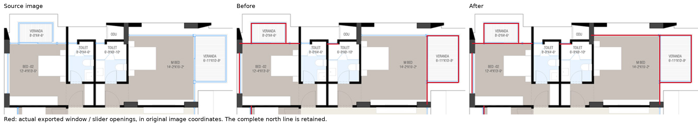

# Window continuity and apartment grouping — 2026-11-03

This patch restores Banani L2–6's missing master-bedroom north window line and separates the drawn Unit A and Unit B
instead of returning the whole floor from either apartment. It builds on the [glazing checkpoint](AUTOTRACE_GLAZING_REPORT_2026-11-03.md).
The result remains a draft: shared-core ownership and several room closures are still wrong.

## Changes and causes

- **Half-pixel disagreement deleted a complete pane.** A long colour-backed glazing line and a shorter gray reading
  of it had axes half a pixel apart. A perpendicular line attached to the shorter reading, leaving the long line just
  outside its final span during pruning. `glazingFrames` now aligns overlapping partial readings to the longer
  positively coloured line within 1.5 px and at least 70% overlap of the shorter reading. Disconnected strokes and
  strokes without colour evidence retain their axes. No source-specific coordinates are used.
- **Apartment labels became false planter barriers.** Text erasure on dark floor fills creates local variance;
  JPEG ringing around coloured UNIT/area stamps also produces sparse green pixels. The planter mask now excludes
  known printed-label neighbourhoods from gray texture seeds. Green inside those neighbourhoods must have local
  support; genuine green patches behind labels and gray foliage outside label boxes remain eligible. This lets the
  existing apartment selector reach the actual UNIT A/B stamps.
- **A glass veranda was claimed by the next apartment.** The north-east veranda adjoins an incompletely closed
  Unit A bedroom. The old low-wall leaf rule kept its walls without assigning its room, allowing Unit B's later
  surrounded-face fallback to claim it. A leaf with positively detected glazing, a balcony label, and an already
  retained boundary is now assigned immediately. Existing foreign-room, shared-core and taken-room checks remain.

Production changes are in `src/trace/faces.ts` and `src/trace/solve.ts`. Evaluation annotations are read only after
normal UI tracing/export. No expected unit, polygon, room count or annotation is supplied to Auto-trace.

## Measured results

The existing eight independent window-line annotations contain 736 approximately one-pixel samples, with unchanged
3 px distance / 5° angle tolerances. This measures the marked glazing, not all walls, rooms or overall accuracy.

| Banani L2–6 scale | Coverage before → after | Precision before → after |
|---|---:|---:|
| Calibrated | 608/736 (82.6%) → 736/736 (100%) | 100% → 100% |
| Automatic | 457/736 (62.1%) → 736/736 (100%) | 98.5% → 99.1% |



For the calibrated whole floor, flat groups change from Unit A alone (16 assigned rooms) to Unit A (13) and Unit B
(3). Seven marked apartment locations cover west bedrooms, kitchen, the recovered north-east veranda, and the east
bedroom/veranda/toilet. All seven have the expected owner in the whole-floor export. Selecting each apartment from
its living room and bedroom gives identical wall/opening geometry in source coordinates; each export contains its
own marked rooms and excludes the other apartment's marked rooms. **35 apartment-location checks pass across those
five workflows.** These are spot checks, not complete apartment polygon annotations.

The two shared lift witness locations remain assigned to Unit A in the whole-floor and Unit A exports: six failed
core-location checks across the five workflows. Unit B excludes them. The checker reports these failures explicitly
and makes no shared-core accuracy claim. Automatic-scale ownership was not given the same acceptance gate.

## Validation and remaining limits

- Real Firefox workflows: image upload, S-tool calibration where specified, Auto-trace, floor/flat selection, then
  Export. **37 paired workflows cover all 29 available images.** After the final veranda ownership fix, all 20
  workflows for flat-bearing sheets were rerun; the 17 common-floor workflows use the preceding run of this patch.
  The before baseline reuses the prior checkpoint's 33 tracing exports plus four fresh living/bedroom selections
  against the frozen pre-change build; the intervening renderer fixes did not change tracing.
  No completed workflow reported a page error. Browser durations include OCR/startup and concurrent workload;
  they are not controlled speed benchmarks.
- The five hand-traced reference flats retain their room-match, opening and wall precision/recall scores, allowing
  floating-point rounding differences. The existing 15 cm wall and 0.6 room-IoU thresholds were unchanged.
- Full suite: **1,284 passed, 27 skipped, 1 todo**; production build (including TypeScript) passed. New targeted
  tests cover overlapping pane axes and planter/text discrimination; the axis ablation and old planter mask fail
  their respective new regressions. The additional half-pixel corner invariant also passes on the earlier code.
- Normal wall edit changed exactly one width from 6 to 8 inches; Undo restored the original wall array. The same
  traced floor opened in Walk and Dollhouse, with a canvas and no WebGL fallback or page error. Preview success
  does not establish geometric correctness.
- Imported derived-room counts increase on automatic Banani L2–6 (14 → 18), L8 (4 → 12), and L9–13 (6 → 13).
  Validation issues also increase (16 → 21, 0 → 22, and 0 → 15 respectively). More rooms alone is not accuracy.
  Banani ground drops from 12 to 11 derived faces: the only removed wall is a roughly seven-pixel segment through
  a tree canopy. Printed labels and 35 validation issues are unchanged; this sheet lacks independent room truth.
- At calibrated scale, imported derived faces remain 17, while Auto-trace reports 16 raw rooms. The master-bedroom
  north pane is restored, but that does not establish that its whole room is correctly closed/named. Formal living,
  dry kitchen and Unit B's open kitchen still appear in review as unclosed. Two lift spaces remain misassigned.
- All 30 source images for the separate expanded benchmark are still absent. Its coverage gate remains unmet.

## Evidence and reproduction

The [evidence directory](tracing-evidence/2026-11-03-round3/) contains comparison JSON, all 37 metric rows,
source-coordinate boundary results, before/after Studio screenshots, 3D/Walk screenshots, test/build logs,
regression-failure logs, acceptance output and source hashes. Actual browser exports and full per-workflow artifacts
are retained locally in ignored `.trace/round3/{before,after}`.

With the local app running, use `scripts/trace-browser.mjs scripts/trace-cases.json <output-directory>` to trace the
manifest through Firefox. Set `TRACE_URL` if the server differs from the harness default. Then measure and check:

```sh
TRACE_BROWSER_DIR=<output-directory> npx vitest run src/trace/acceptance.test.ts
node scripts/check-trace-results.mjs <output-directory>
node scripts/trace-compare.mjs <before-directory> <output-directory> <report-directory>
```

`scripts/trace-ownership.json` and `scripts/trace-boundaries.json` are evaluation-only source annotations. The
ownership checker requires all annotated locations and expected flat groups, checks consistent click geometry,
requires complete marked glazing coverage, and separately reports the known shared-core failures.

See the [complete before/after table](tracing-evidence/2026-11-03-round3/table.md) and
[machine-readable measurements](tracing-evidence/2026-11-03-round3/comparison.json).
