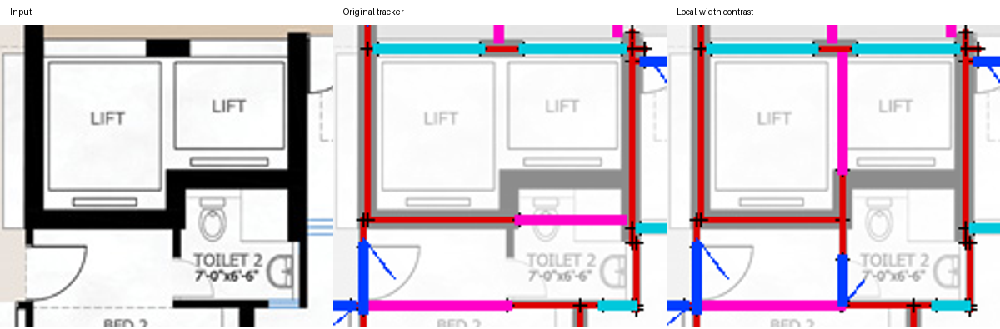

# Tracing improvement and verification — 2026-11-03

Plotline now retains short walls at thickness changes that its contrast check previously rejected. The real Studio
recovers the missing wall between a toilet and the lift core on Sheltech Level 2. **This is a targeted improvement;
automatic tracing is still incomplete on these drawings. The broad reliability goal is not fully achieved.**

## Diagnosis and change

The active path is Studio → Auto-trace worker → `prepare` / `pickFloor` or `pick` → wall tracks, room fitting and thin-face
repairs → Studio import / join-walls → derived rooms. The renderer builds the resulting graph; it cannot recover a
wall discarded upstream.

On Sheltech L2, the black stepped wall at image x434–444, y404–423 was missing even from the wall-stage output.
Testing the original raster, text-erased raster and furniture / hatch / dash masks separately reproduced the loss.
Disabling the contrast filter recovered it, locating the fault in wall acceptance rather than OCR or import.

The track classifier absorbs short width runs into an adjacent thickness class. At this junction a thick stretch
inherited the thin continuation's width. The old contrast probe sampled just beyond that narrow assumed width:
its supposed outside samples were still inside black wall ink, so the real wall appeared to have no contrast.

`src/trace/tracks.ts` now judges contrast on actual wall cross-sections at their measured local widths. Crossing blocks
are excluded from that evidence. The existing contrast threshold, gap rules, geometry contract and review checks remain.
The change introduces no project-specific rule and makes no change to `src/core`.



## Measured gains and regressions

At the same UI-calibrated scale, Sheltech L2 whole-floor output changes from **31 to 32 closed, named rooms**.
The “Toilet 2 and Lift share one space” warning disappears. Its Type B count changes from 12 to 13 of the 14 names
the reader found; whole-floor validation warnings change from 5 to 4. These counts are not the number of all rooms
printed on the sheet: unread names and missing verandas remain.

The automatic-scale run independently changes from 31 to 32 rooms, at the same 26.8619 px/m before and after.
The calibrated run stays at 27.0757 px/m. Scale drift therefore does not explain the recovered room.
Single-flat Type B selection changes from 13 to 14 rooms. Sheltech Levels 5 and 6 change from 33 to 34 rooms each;
their images are identical and are reported separately, not treated as independent evidence of generalization.

The existing hand traces provide a second, imperfect geometry reference: rooms match one-to-one at IoU ≥0.6 and
wall samples use the existing 0.15 m / angle tolerance, registered against the original image ink. No scoring
tolerance or expected annotation was changed. These traces have documented local drift, so the input crop is also
needed to assess the repaired junction. The geometry table below includes regressions rather than hiding them.

| Workflow / reference | Room matches | Wall recall | Wall precision | Matching openings |
|---|---:|---:|---:|---:|
| sheltech-l2 / unit_sheltech_a_2736 | 17 → 17 / 21 | 72.4% → 72.4% | 64.7% → 64.3% | 26 → 26 / 34 |
| sheltech-l2 / unit_sheltech_b_2736 | 13 → 15 / 20 | 71.6% → 71.2% | 74.9% → 73.8% | 17 → 18 / 32 |
| sheltech-l2-b / unit_sheltech_b_2736 | 12 → 13 / 20 | 61.8% → 66.5% | 85.5% → 84.2% | 15 → 16 / 28 |
| btibd-img-2 / unit_type_b_1747 | 21 → 21 / 22 | 94.9% → 94.9% | 84.3% → 84.2% | 28 → 28 / 30 |
| btibd-img-2 / unit_type_c_2254 | 20 → 20 / 26 | 91.9% → 91.9% | 81.5% → 81.5% | 24 → 24 / 31 |
| btibd-img-3 / unit_type_a_2703 | 16 → 16 / 27 | 60.9% → 60.9% | 67.6% → 67.6% | 21 → 21 / 34 |

Important limitations and investigated regressions:

- The repaired whole-floor junction changes adjacent wall ends and enables an additional thin low boundary around
  the lift symbol. Whole-floor wall precision falls slightly on both Sheltech reference regions, despite better
  room separation. The thin-face pass can still promote a lift-symbol line to an architectural boundary. This
  remains a geometry defect; the new room count is not proof of completely faithful walls.
- Type B selected alone gains a room and wall coverage but its dangling-end warnings increase from 1 to 3, and
  reference wall precision decreases. Its additional retained/core-adjacent segments need review. Warnings remain
  visible. No unrelated boundary is forcibly joined to suppress them.
- BTI `img_3` has one fewer opening overall (68 → 67), but matching openings in the reference Type A remain 21 and
  matched reference rooms remain 16. The change is outside the matching-opening set; it is not evidence of an
  improvement to all openings.
- BTI ground `img_5` drops from 17 to 12 walls and 3 to 2 unnamed rooms. Screenshots locate the affected draft in
  foliage / landscaping, at a clearly poor automatic scale (~18.67 px/m versus much larger scale for the flat sheets).
  Both results are inadequate; this loss is recorded, not counted as a successful architectural correction.
- Banani thin/outlined boundaries and DMD low-resolution drawings remain badly incomplete. Their common levels
  often trace only a lift or toilet block, or parking/furniture outlines. This patch does not solve those styles.
- The baseline DMD ground run produced no completed draft. The after run exported 20 walls / 2 rooms, still a poor
  partial reconstruction. There is no paired baseline geometry for that case, so no quantified gain is claimed.

## Browser verification and coverage

Firefox 155 / Playwright, 1600×1100 viewport, fresh browser context per case, no AI key and no mock-trace mode.
The baseline used the unmodified production build on port 5174; after runs used the Studio on port 5173.
Every trace started with an actual image upload. Known scale was entered through S and two mouse clicks.
Whole floor and both Sheltech L2 flat selections were exercised. JSON was exported only after tracing for measurement.
No prepared Unit or expected benchmark room annotation was supplied to the tracing pipeline.

All **29 source images** in the four `Demo drawings/` folders were attempted before and after. Three additional
calibration / selection cases give 32 workflow cases. There are 31 successful paired exports; all 32 after cases
exported. An interrupted baseline attempt was rerun successfully and is not counted as a product crash.
Common-level runs are smoke/diagnostic coverage, not claims of supported accurate common-level Auto-trace.

The measured drafts still identify Type A and Type B on Sheltech L2. The browser edit check changed exactly one wall
from its generated width to 8 inches, exported it, then used Undo and verified that the original wall array was
restored. Preview 3D was entered and visibly rendered in both Walk and Dollhouse; it was not just checked at the
initial Ready screen. These checks cover a representative Type A flat, not every draft or VR.

- [Before Studio](tracing-evidence/2026-11-03/before-studio.png) · [After Studio](tracing-evidence/2026-11-03/after-studio.png)
- [Walk](tracing-evidence/2026-11-03/walk.png) · [Dollhouse](tracing-evidence/2026-11-03/dollhouse.png)
- [All-sheet comparison 1](tracing-evidence/2026-11-03/sheets-1.jpg) · [2](tracing-evidence/2026-11-03/sheets-2.jpg) · [3](tracing-evidence/2026-11-03/sheets-3.jpg) · [4](tracing-evidence/2026-11-03/sheets-4.jpg)
- [Editing evidence](tracing-evidence/2026-11-03/editing.json) · [Preview evidence](tracing-evidence/2026-11-03/preview.json)
- [Per-case measurements, dimensions, room/flat groups and reference misses](tracing-evidence/2026-11-03/comparison.json)

Contact sheets show framing differences between runs; the exported geometry is measured in the source image frame.
Full-resolution input/Studio screenshots, page text, exports and available reference overlays remain in
`.trace/baseline-browser-all/` and `.trace/after-browser-all/`. Intermediate diagnostics are in `.trace/baseline-diagnostics/`,
`.trace/masks/` and `.trace/masks-after/`. These generated folders are ignored by Git.

## Per-case results

Values are before → after, measured **after Studio import**, so they can differ from the “Traced …” raw-stage summary.
“Named” means a derived room has a label; it does not establish that its name or boundary is correct. Validation
includes warnings; their exact codes and available printed-size discrepancies are in the JSON. Independent counts of
missing/false walls, false rooms/columns and correct room names are **unmeasured** on sheets lacking reference annotations.
There is no new all-sheet ground truth in this change. Existing reference-room misses are retained individually.
Runtime includes upload, OCR, tracing, screenshot and export under varying concurrent CPU load. These are observed
times, not a controlled speed benchmark; no performance improvement is claimed.

| Case | Walls | Rooms | Named | Openings | Validation issues | Review rows | Seconds |
|---|---:|---:|---:|---:|---:|---:|---:|
| sheltech-l2 | 196 → 199 | 31 → 32 | 31 → 32 | 63 → 64 | 5 → 4 | 68 → 66 | 17 → 65 |
| sheltech-l2-auto | 195 → 198 | 31 → 32 | 31 → 32 | 63 → 64 | 5 → 4 | 67 → 65 | 26 → 39 |
| sheltech-l2-a | 93 → 93 | 15 → 15 | 15 → 15 | 30 → 30 | 2 → 2 | 31 → 31 | 26 → 44 |
| sheltech-l2-b | 88 → 96 | 13 → 14 | 13 → 14 | 28 → 30 | 1 → 3 | 28 → 29 | 37 → 60 |
| btibd-img-1 | 4 → 4 | 1 → 1 | 1 → 1 | 2 → 2 | 0 → 0 | 0 → 0 | 28 → 66 |
| btibd-img-2 | 235 → 237 | 49 → 49 | 44 → 44 | 69 → 69 | 7 → 7 | 90 → 91 | 78 → 124 |
| btibd-img-3 | 226 → 227 | 41 → 41 | 34 → 34 | 68 → 67 | 16 → 16 | 84 → 86 | 61 → 101 |
| btibd-img-4 | 18 → 18 | 4 → 4 | 2 → 2 | 4 → 4 | 0 → 0 | 8 → 8 | 40 → 59 |
| btibd-img-5 | 17 → 12 | 3 → 2 | 0 → 0 | 2 → 2 | 0 → 0 | 4 → 3 | 164 → 117 |
| sheltech-basement-1 | 10 → 10 | 0 → 0 | 0 → 0 | 2 → 2 | 4 → 4 | 6 → 6 | 35 → 15 |
| sheltech-basement-2 | 4 → 4 | 1 → 1 | 0 → 0 | 0 → 0 | 0 → 0 | 3 → 3 | 23 → 11 |
| sheltech-ground-floor | 16 → 16 | 3 → 3 | 3 → 3 | 4 → 4 | 0 → 0 | 5 → 5 | 22 → 17 |
| sheltech-level-1 | 40 → 40 | 8 → 8 | 6 → 6 | 13 → 13 | 2 → 2 | 16 → 16 | 16 → 26 |
| sheltech-level-3 | 217 → 217 | 38 → 38 | 35 → 35 | 63 → 63 | 10 → 10 | 95 → 95 | 28 → 35 |
| sheltech-level-4 | 211 → 212 | 33 → 33 | 32 → 32 | 63 → 63 | 9 → 9 | 72 → 73 | 40 → 57 |
| sheltech-level-5 | 197 → 200 | 33 → 34 | 30 → 31 | 65 → 65 | 8 → 8 | 85 → 88 | 40 → 83 |
| sheltech-level-6 | 197 → 200 | 33 → 34 | 30 → 31 | 65 → 65 | 8 → 8 | 85 → 88 | 40 → 60 |
| sheltech-rooftop | 4 → 4 | 1 → 1 | 1 → 1 | 0 → 0 | 0 → 0 | 6 → 6 | 12 → 9 |
| sheltech-banani-basement-1 | 4 → 4 | 1 → 1 | 1 → 1 | 2 → 2 | 0 → 0 | 3 → 3 | 28 → 21 |
| sheltech-banani-basement-2 | 42 → 42 | 7 → 7 | 4 → 4 | 5 → 5 | 10 → 10 | 27 → 27 | 31 → 25 |
| sheltech-banani-ground-level | 7 → 7 | 1 → 1 | 0 → 0 | 2 → 2 | 6 → 6 | 9 → 9 | 32 → 21 |
| sheltech-banani-level-2-6 | 82 → 85 | 8 → 8 | 6 → 6 | 13 → 13 | 27 → 25 | 52 → 51 | 24 → 35 |
| sheltech-banani-level-7 | 85 → 85 | 8 → 8 | 6 → 6 | 23 → 23 | 20 → 20 | 49 → 49 | 20 → 55 |
| sheltech-banani-level-8 | 22 → 22 | 4 → 4 | 3 → 3 | 8 → 8 | 0 → 0 | 9 → 9 | 27 → 40 |
| sheltech-banani-level-9-13 | 20 → 20 | 4 → 4 | 1 → 1 | 7 → 7 | 0 → 0 | 7 → 7 | 29 → 52 |
| sheltech-banani-roof-level | 13 → 13 | 2 → 2 | 1 → 1 | 2 → 2 | 1 → 1 | 6 → 6 | 14 → 14 |
| sheltech-dmd-basement-1 | 10 → 10 | 2 → 2 | 1 → 1 | 4 → 4 | 0 → 0 | 6 → 6 | 31 → 17 |
| sheltech-dmd-basement-2 | 3 → 3 | 0 → 0 | 0 → 0 | 0 → 0 | 2 → 2 | 3 → 3 | 18 → 22 |
| sheltech-dmd-ground-level | before failed  | — | — | — | — | — | — |
| sheltech-dmd-level-2 | 16 → 16 | 4 → 4 | 1 → 1 | 4 → 4 | 0 → 0 | 8 → 8 | 19 → 11 |
| sheltech-dmd-level-3-14 | 9 → 9 | 2 → 2 | 1 → 1 | 3 → 3 | 0 → 0 | 10 → 10 | 25 → 19 |
| sheltech-dmd-roof-level | 4 → 4 | 1 → 1 | 1 → 1 | 0 → 0 | 0 → 0 | 6 → 6 | 17 → 12 |

## Automated checks and reproduction

- Initial unmodified suite: 1,261 passed, 24 skipped, one todo; initial build passed.
- Full changed suite: **1,267 passed, 27 skipped, one todo**, using `npm test -- --maxWorkers=2 --testTimeout=30000`.
  The longer per-test timeout avoids CPU-contention timeouts while the browser batches run; assertions are unchanged.
- Final targeted run: 8 passed, one optional benchmark skipped (`contrast.test.ts` and score30 rules).
- Final `npm run build` passed. Script syntax checks and `git diff --check` passed.
- The new real-image junction regression was run against an isolated copy of the original tracker: it failed
  (zero matching risers). It passes with the patch. Five additional tests cover stepped-wall alignment at three
  resolutions, rejection of low-contrast fill, and preservation of an intentional paper gap. These are six tests,
  not six independently fixed real-plan failures.
- `npm run score30` was explicitly run and **failed coverage: 0 of 30 fixtures available**. All expanded-benchmark
  image files are absent. [Every missing key](tracing-evidence/2026-11-03/missing-benchmark.json) maps to its source path
  in `src/trace/eval/sheets30.json`. This is not a full benchmark pass. The 29 available images are a separate corpus.

The fixture script uses the installed Playwright package and portable image-path resolution. The scorer writes
coverage and fails when requested sheets are missing instead of accepting a partially populated run.

```sh
npm ci
npx playwright install firefox
node scripts/trace-fixtures.mjs --rgb .trace/fixtures
npm run dev -- --host 127.0.0.1
# Another terminal:
node scripts/trace-browser.mjs scripts/trace-cases.json .trace/recheck
TRACE_BROWSER_DIR=.trace/recheck npx vitest run src/trace/acceptance.test.ts
TRACE_EDIT=sheltech-l2-a TRACE_PREVIEW=sheltech-l2-a node scripts/trace-browser.mjs scripts/trace-cases.json .trace/recheck-ui sheltech-l2-a
npm test -- --maxWorkers=2 --testTimeout=30000
npm run build
```

For before/after comparisons, serve each revision separately and set `TRACE_URL` to the appropriate server. Run
`trace-compare.mjs` on the two measured output directories. `TRACE_DIAGNOSTIC=1 TRACE_OUT=.trace/diagnostics` with
`acceptance.test.ts` records the current Sheltech L2 stages after fixture preparation. No paid service is required.

Next work needs to address thin-face false boundaries, missing thin/outlined walls, scale failures and OCR on the
remaining styles, with independent annotations beyond the existing five hand-traced flats. This report does not
certify that all available designs now reconstruct correctly.
