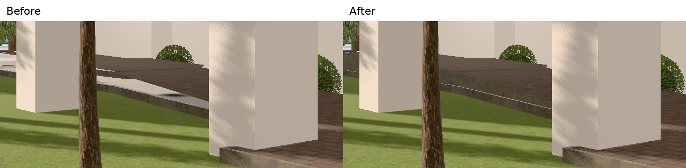
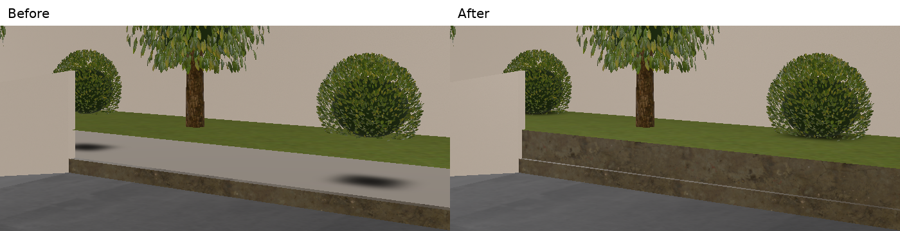
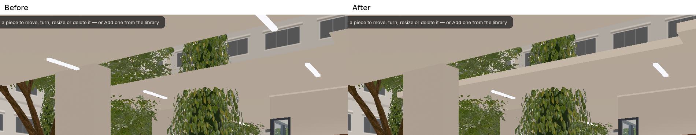

# Ground-floor rendering fixes — 2026-11-03

The Sheltech ground-floor screenshots exposed three rendering defects. The fixes use the existing wall graph and
room levels; the drawing data and tracing changes are preserved.

- **Open sides under raised ramps and paths.** Retaining faces were generated only on zero-height boundaries. A
  15 cm kerb beside a much higher ramp therefore left a visible gap between its top and the ramp. `stepFaces` now
  fills the uncovered height above short walls/kerbs, clipping at the point where a sloping floor meets the wall top.
  Full-height walls continue to fill their own sides without an extra overlapping face.
- **Detached dark patches beside the planting.** Contact shadows were drawn on a single plane 14 mm above the
  datum. Plants on raised lawns cast this artificial mask onto the lower driveway. Contact masks now belong to their
  own rooms, follow their floor levels/slopes and stop at their floor polygons. Removed pieces generate no contact
  mask. Masks and geometry are disposed when furniture changes or the scene is rebuilt.
- **Paper-thin slab edges and protruding lights.** Covered zones used one-sided soffit planes. They now have a closed
  15 cm slab with sides and caps. Batten placement checks its ends and interior against the cover footprint, with edge
  clearance, instead of accepting only its centre. Partially covered zones are checked at each candidate location.
  Valid overhead slabs from the building data remain present.







## Verification

- Firefox on the actual built-in `/u/sheltech-ground` route, using Enter, Rooms and ordinary viewer controls at the
  east ramp, north-east driveway and lawn. Before/after views use matching camera gestures and Lite quality, matching
  the supplied screenshots. No Unit, camera or scene state was injected. Full raw images are in ignored
  `.trace/render-fixes/before-final/` and `.trace/render-fixes/after-final/`.
- The final production build also rendered a normal Type A flat and Sheltech Basement 1 in Walk and Dollhouse.
  All checked scenes had a 3D canvas, no fallback and no page errors. These are representative browser checks, not VR
  or an exhaustive visual check of every floor.
- Six new regression tests cover a raised floor above a kerb, clipping a sloping retaining face, removed-piece shadows,
  raised/sloping shadow geometry confined to its room, solid angled slab edges, and fixture placement across partial
  cover, adjoining polygons and a narrow void.
- Full suite: **1,281 passed, 27 skipped, one todo** with
  `npm test -- --maxWorkers=2 --testTimeout=30000`. Production build and TypeScript pass. The tracing checkpoint's
  separately documented missing 30-sheet dataset remains unavailable.

Reproduce the ground-floor browser checks against a local running app:

```sh
node scripts/verify-ground.mjs http://127.0.0.1:5173 .trace/ground-check
```

[Tests](rendering-evidence/2026-11-03/tests.log) · [Build](rendering-evidence/2026-11-03/build.log) ·
[Browser checks](rendering-evidence/2026-11-03/after-browser.json) ·
[Additional scenes](rendering-evidence/2026-11-03/smoke.json).

Changes are in the local checkout. No deployment was performed.
