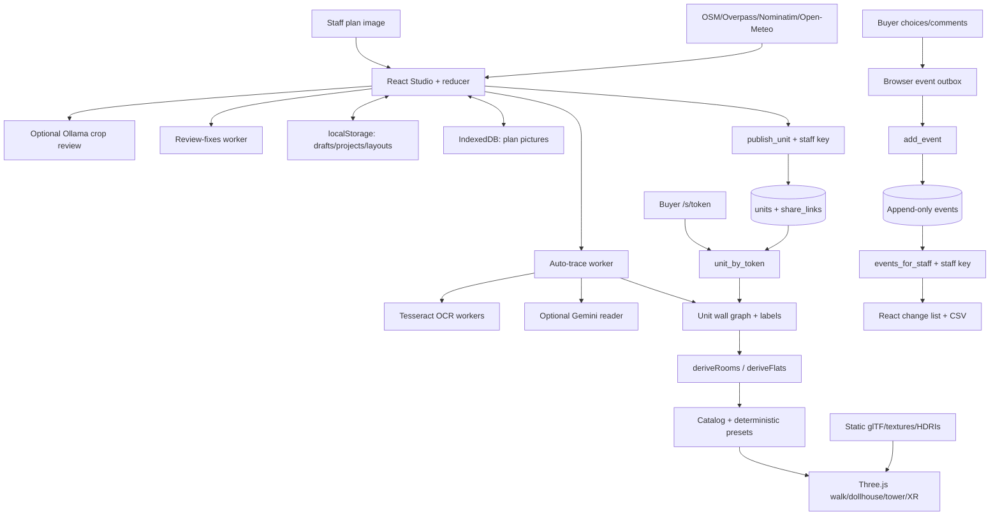

# Plotline architecture overview

Audit date: **2026-11-02 (Asia/Dhaka)**. Workspace commit: `c76e4b74c77f3b3e78e8a02fe324d46d3394183d`. Only the six audit Markdown reports were added; application source, dependencies, environment and configuration were unchanged.

## Product and actual stack

Plotline is a digital show-flat tool: developer staff trace/edit a floor-plan image, generate a furnished browser/VR walkthrough, and publish snapshots. Buyers explore, choose finishes and leave comments. Staff read an append-only change list and export CSV.

The active implementation uses React 19, TypeScript, Vite, Three.js, Tesseract.js and Supabase PostgreSQL RPC. Exact declared/locked versions are in package.json/package-lock.json; installed compatibility was not tested. There is no React router/state library, Supabase JS SDK, custom HTTP server, ORM or payment implementation. Vercel SPA routing is explicitly configured, but deployed settings were not inspected.

## Directory map

```text
src/main.tsx             Lazy React entry; pathname dispatch
src/core/                Pure graph, geometry, units, flats and site/sun/wind math
src/studio/              Editor/reducer/drawing/review, files and local AI
src/trace/               Raster/OCR/wall/room/flat solver and eval helpers
src/furnish/             Kit/texture registry, presets and procedural builders
src/three/               Scene/geometry/PBR/daylight/context/controls/WebXR
src/viewer/              Buyer UI, finishes, notes, sharing, local staff editors
src/data/units/          20 built-in Unit JSONs
src/data/building/       Four built-in tower modules and local project adapter
src/data/fixtures/       Reference fixtures
supabase/migrations/    Snapshot/capability and append-only event SQL
scripts/                Share verification and image-fixture conversion
public/assets/          Models/buffers/textures/HDRIs/plans/license manifest
Docs/                   Product/manual/source/evaluation documentation
plotline_1.2/            Archived JS prototype; not production entry
HANDOFF.md              Historical development log
graphify-out/           Generated local-tool metadata; excluded
```

## Data flow



The renderer derives rooms, builds walls/floors/openings, bakes daylight synchronously, assigns materials and starts furniture loads. `/u/:id` resolves eagerly imported built-ins or local Studio project drawings. `/u/preview` reads local preview storage. `/s/:token` fetches/normalizes a published Unit, applies defaults and renders it. `/studio` and `/changes` are separate lazy React components. Navigation is mostly full-page links/history replacement; pathname dispatch is not a reactive router.

## Model and persistence

Unit stores vertices, walls with child openings, room labels, optional pillars/site, furniture and structured finish slots. Rooms are derived graph faces; flats are derived connected room groups. Lengths are meters, money integer BDT and IDs use crypto.randomUUID. Mirroring remaps graph IDs/offsets and reruns furniture presets. Keep this separation.

Local storage owns drafts/projects/layouts/local notes/answer logs/settings and staff credentials. IndexedDB stores pictures. Export is one Unit plus the image name, not a whole project backup. projectTower adapts local drawing/floor assignments to the same Tower shape used by built-ins. Whole-floor drawings currently become one viewer flat entry; selected derived-flat routing is incomplete.

## Actual database and API contracts

| Resource | Implemented structure/access |
|---|---|
| units | UUID ID, name, JSONB snapshot, created_at |
| share_links | UUID token, unit FK, created_at; no org/expiry/revocation |
| events | Client UUID ID, token FK, comment/selection, ref, buyer/name, JSONB payload, server receipt time |
| private.config | One generated staff_key; not a normal public table endpoint |
| publish_unit(p_unit,p_key) | Checks shared key; inserts unit/link in one function transaction; returns UUID token |
| unit_by_token(p_token) | Returns token snapshot JSONB or null |
| add_event(...) | Inserts supplied fields; ignores duplicate IDs; returns ID |
| events_for_staff(p_key) | Checks global key; returns all links/events; supersession by token/kind/ref and receipt time |

RLS is enabled and anon/authenticated table privileges are revoked. Public RPCs use SECURITY DEFINER, explicit public search_path and explicit anon grants. These controls should remain. The shared key is the server staff authorization; `?staff=1` and the local flag merely enable local editor UI. There are no implemented org/membership/account tables, individual staff sessions, separate buyers table, shared project storage or edge-function API. The target architecture describes a later design, not the current schema.

## External services and build/deployment

Models/maps/HDRIs are primarily same-origin files; the license manifest records Poly Haven/ambientCG provenance, not an independent legal certification by this audit. Google Fonts is external. Gemini sends cropped image data with an optional user-configured browser key; Ollama sends a crop to the configured endpoint. OCR dynamically imports Tesseract and uses default worker/language loading unless options override paths; offline availability was not verified.

Site fetches run in Studio, then embed context in Units so buyers do not refetch it. The OSM editing-API fallback needs replacing. No active backend file upload exists: image/JSON imports are browser-local.

`npm run build` is `tsc -b && vite build` to dist. vercel.json rewrites non-assets/non-plans paths to index.html. No custom API deployment/health endpoint is present. The secret guard misses the VITE naming path (P2-028). Runtime, production build, hosted rewrites/security headers/TLS and backup settings remain unverified.

## Architecture recommendations

Keep React/Vite/Three.js, the graph/pure API, deterministic presets, structured finishes, shared Tower adapter, append-only history and event UUID idempotency. Add runtime schemas, actual scoped staff authorization, transactional/versioned persistence and explicit asynchronous/GPU ownership. Extract storage/loader/worker boundaries from large components; no framework replacement or microservice split is justified.
