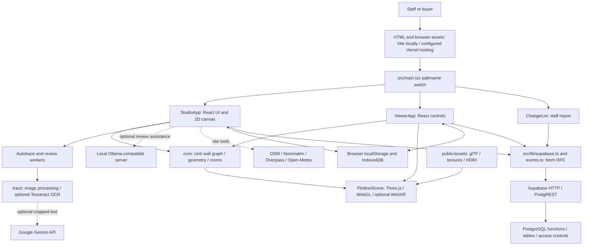

# How Plotline fits together

Plotline is a single-page browser application with three entry experiences: Studio, Viewer, and a staff change list. It combines a substantial local application with a hosted SQL backend. There is no custom Node HTTP server to start. Vite serves development files; Vercel is the configured frontend host; Supabase provides the remote data API and PostgreSQL.

## The actual system



External calls are feature-dependent. Local built-in viewing and manual editing do not inherently need an AI service, Supabase account, or locally running database.

## Repository map

| Directory/file | Responsibility | Read it when… |
|---|---|---|
| [src/main.tsx](../../src/main.tsx) | Mount React; select Studio/changes/Viewer by pathname; lazy entry modules. | You need to understand startup or navigation. |
| [src/core](../../src/core/) | Types, lengths, geometry, graph traversal, rooms, flats, site/sun/wind calculations. | You are changing the meaning of floor-plan data. |
| [src/data](../../src/data/) | Built-in unit JSON, drawing fixtures, building/project adapters. | You need a concrete example of a valid plan. |
| [src/studio](../../src/studio/) | React editing UI, reducer/history, snapping/drawing, project tools, image storage, worker coordination. | You are changing plan editing or draft lifecycle. |
| [src/trace](../../src/trace/) | Image-to-plan pipeline, OCR, dimension interpretation, wall/room reconstruction, evaluation. | You are changing automatic tracing. |
| [src/furnish](../../src/furnish/) | Catalogs, finishes, placement presets, procedural pieces, asset metadata. | You are changing furnishings/material choices. |
| [src/three](../../src/three/) | Scene construction, camera/control integration, openings, daylight, surrounding buildings, XR. | You are changing rendered geometry or interaction. |
| [src/viewer](../../src/viewer/) | Viewer UI, share configuration, local layouts/pins, quality decisions, buyer interactions/report. | You are tracing a walkthrough feature. |
| [src/lib](../../src/lib/) | Remote RPC wrapper and buyer-event outbox/report helpers. | You need to follow a network request. |
| [supabase/migrations](../../supabase/migrations/) | Server-side schema, privileges, SQL functions, event immutability. | You are changing shared persistence or authorization. |
| [scripts](../../scripts/) | Fixture/browser/share verification utilities; some assume the original Windows machine. | You are investigating extra tooling, not ordinary startup. |
| [public/assets](../../public/assets/) | Public static rendering assets. | A material/model request fails or size matters. |
| [Docs](../../Docs/) | Product manual, key reference, sources, plans. | You need the intended user behavior and constraints. |

The two large orchestrators, `StudioApp.tsx` and `ViewerApp.tsx`, connect many smaller modules. Do not try to memorize them linearly. Start with one named handler, then follow its imports and state changes. The length of a file is a maintenance concern, not a reason to bypass it when tracing current behavior.

## The data model that ties the layers together

[core/types.ts](../../src/core/types.ts) defines `Unit`, the shared plan representation. A unit contains identifying metadata, vertices, walls, room labels, and optional furniture, finishes, plan-image/site information, and other features. Walls connect vertex IDs; openings belong to walls and carry offsets/dimensions. Geometry functions derive rooms from this graph.

Important invariants:

1. Store plan coordinates in **meters**, with plan x increasing right and plan y increasing down. Three's world is y-up: plan axes are mapped to world x/z. Image pixels are another coordinate system entirely.
2. Use one authoritative wall graph. A room label names a derived face; it is not an independent polygon to keep synchronized by hand.
3. Preserve stable object IDs. Furniture anchors, openings, finish references, selections, and comments can depend on them.
4. Support arbitrary wall directions; avoid “all rooms are rectangles” assumptions.
5. Finish price deltas are integer BDT values. A displayed finish delta is not a server-verified apartment sale price.
6. Buyer change history is append-only. A newer selection supersedes an older row rather than mutating it.

A TypeScript interface describes expected shape during development. Imported JSON, local storage, and network responses still need runtime checks. Existing guards are not complete schema validators; `as Unit` does not make corrupt data valid.

## Startup and routing

`index.html` loads `src/main.tsx`. React DOM mounts into `#root`. `React.lazy` defers loading each main component, and Suspense displays “Loading…” while its module loads.

| URL family | Entry | More detailed resolution |
|---|---|---|
| `/studio` | Studio | Initializes reducer and browser draft/project state. |
| `/changes` | ChangeList | Staff key prompts/report RPC path. |
| `/u/:id` | Viewer | Built-in JSON stem/ID or supported browser project unit lookup. |
| `/u/preview` | Viewer | Reads a Studio preview saved in this browser origin. |
| `/s/:token` | Viewer | Fetches snapshot with `fetchSharedUnit(token)`. |
| `/` and other entry paths | Viewer | Default/resolution behavior is implemented in `ViewerApp.tsx`. |

There is no route registry, router outlet, or general client navigation subscription. `main.tsx` reads `location.pathname` at startup. `history.replaceState` can update a URL without reloading, but does not itself cause the entry component to rerun. Direct navigation and page reload behavior depend on the host serving `index.html`; [vercel.json](../../vercel.json) contains that fallback while excluding `/assets/` and `/plans/`.

## Local editing lifecycle

```text
Pointer/key/input event in StudioApp or Panel
  → convert screen/image coordinates or parse typed dimensions
  → dispatch an action
  → studio/review.ts routes review-related work and model.reducer handles editing
  → next immutable unit + selection/history state
  → memoized deriveRooms / deriveFlats and issue calculations
  → canvas drawing effect schedules redraw
  → debounced saveDraft writes local draft
  → Preview stores plotline.preview and opens /u/preview
```

`useReducer` keeps editing transitions explicit. Undo/redo uses plan snapshots; adding a second independent editing state in a panel would risk disagreement with the authoritative unit. `useRef` gives callbacks access to current values and holds imperative objects; it does not trigger renders when changed.

Auto tracing adds a worker round trip: the UI rasterizes a drawing, transfers buffers to `autotrace.worker.ts`, receives progress/previews/results, and applies an accepted plan through the reducer. `trace/solve.ts` coordinates image normalization, text/dimension reading, wall reconstruction, and room inference. These are fallible estimates for human review, not a promise that arbitrary drawings become correct without inspection.

Project/floor workflows exist in Studio and building adapters, and whole-floor/flat detection is present. Some desired project-first and individual-flat navigation behavior remains incomplete. Product plans describe goals; current handlers and tests determine what actually works today.

## Viewer lifecycle

`ViewerApp.tsx` resolves a unit, reads applicable configuration/layout state, derives rooms, and creates `PlotlineScene` after a canvas exists. Scene methods build meshes, load catalog assets/materials, and respond to control/configuration changes. Cleanup disposes the scene when its owning effect ends.

React handles menus, forms, selected options, loading UI, and other relatively infrequent changes. Three manages frame-by-frame camera and GPU rendering. Pin markers and minimap updates also use imperative animation where appropriate; forcing every frame through React state would add unnecessary work.

Quality selection probes device/WebGL capabilities and considers user or URL choices. A 2D fallback is available when suitable 3D support is unavailable. VR additionally requires a compatible headset/browser and a secure context/device permission; the development emulator is not evidence of physical-headset correctness.

## Remote sharing lifecycle

```text
Studio Share → publishUnit(unit, staffKey)
  → rpc('publish_unit', {p_unit, p_key})
  → POST Supabase /rest/v1/rpc/publish_unit
  → SQL checks staff key and inserts units + share_links
  → UUID share token → /s/token copied for buyer
Buyer opens link → unit_by_token → JSON snapshot → Viewer scene
Buyer selects/comment → event ID + local outbox → add_event
Staff opens changes → events_for_staff → grouped history/report
```

Publishing creates a new snapshot/link; it does not establish live synchronization between the draft and every existing link. Viewer configuration sharing is another mechanism: URL configuration encodes finish/view choices, and does not publish a Studio draft by itself.

The browser's current local-layout merge can affect what a fetched shared unit displays. Treat “published snapshot is isolated from all local state” as a requirement to verify, not a proven property. See the existing [audit reports](../../audit-reports/) for recorded implementation issues.

## Storage and trust boundaries

| Location | Lifetime and responsibility | Does another buyer receive it automatically? |
|---|---|---|
| React state / refs | Current page session and live UI/scene objects. | No. |
| localStorage | This browser profile and origin: drafts, layouts, pins, settings, buyer ID, outbox. | No. Local preview needs the same origin/profile. |
| sessionStorage | Current tab/origin session: graphics fallback state and its note in `viewer/quality.ts`. | No. |
| IndexedDB | This browser origin: per-drawing plan pictures. | No. |
| Checked-in JSON/assets | Shipped with application deployment. | Yes, publicly accessible assets/data shipped by the app. |
| PostgreSQL snapshots/links/events | Hosted shared persistence through allowed functions. | Only according to the actual token/key access design. |

UI visibility checks such as a staff flag are not backend authorization. Public Supabase keys are expected to be visible. The real protections are function privileges, staff-key checks, token possession, RLS/table grants, and server-side validation. Current scope is one shared staff key rather than organization-scoped users. Read [backend](05-BACKEND-GUIDE.md) before modifying this boundary.

Next: [03 — Development tools](03-DEVELOPMENT-TOOLS.md).
