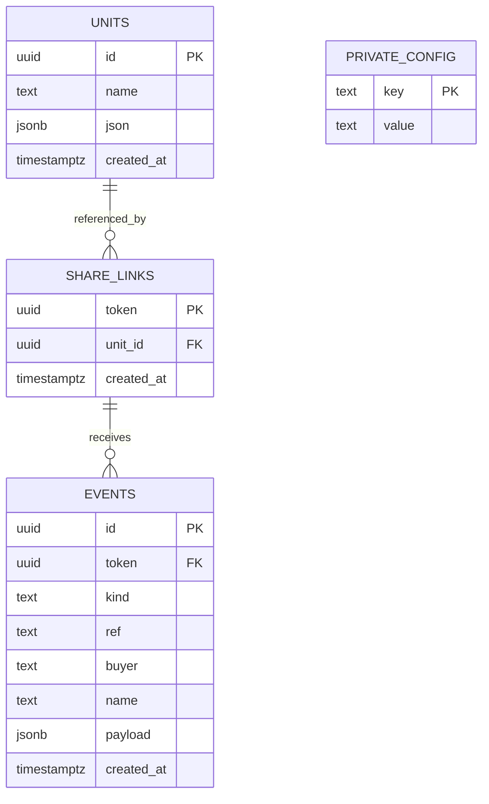

# Database and browser storage

Plotline has several persistence layers with different purposes. A saved editor draft is not automatically a cloud record, and a published snapshot is not automatically updated by a later draft edit. Understanding ownership and lifetime prevents apparent “missing data” bugs.

## Storage inventory

| Store | What lives there | Access and lifetime |
|---|---|---|
| React state / refs | Active UI, selected tool/element, current plan, scene objects. | Memory only, rebuilt on reload. |
| Built-in JSON | Example units and building mappings in `src/data/`. | Versioned source; bundled/imported by application. Not editable remotely by changing a browser draft. |
| localStorage | Studio draft/projects, Viewer layouts/pins, preview, preferences, staff-key memory, buyer metadata, outbox. | Synchronous string storage, scoped to browser profile and origin; quota and access can fail. |
| sessionStorage | Per-tab graphics fallback state/note, accessed through `viewer/quality.ts`. | Scoped to an origin and tab session; distinct from persistent quality preferences in localStorage. |
| IndexedDB | Drawing pictures keyed by unit ID, database `plotline`, object store `pictures`, version 1. | Asynchronous browser storage; also origin/profile scoped. |
| Hosted PostgreSQL | Published unit snapshots, share-link mappings, buyer history, private staff configuration. | Shared remote persistence through allowed RPC functions. |
| Public asset files | Plan/reference assets, glTF, binary geometry, texture maps, HDRI. | Static HTTP files, not private database objects. |

`localhost:5173`, `127.0.0.1:5173`, a preview deployment, and a production domain are different origins. A changed port can also make local data appear absent. Browser storage is not cross-device synchronization or a backup guarantee.

## PostgreSQL schema and relationships



The diagram shows permitted relational cardinality; `publish_unit` currently creates one new link for each new unit snapshot. `private.config` is separate, with a `staff_key` entry read by privileged functions, not a foreign-key relationship.

**Primary key** identifies one row uniquely. **Foreign key** requires a referenced row to exist. **JSONB** stores a JSON document in PostgreSQL's structured JSON representation; its key order need not match the original text. **timestamptz** represents a timestamp with time-zone-aware interpretation. An **index** helps locate/order rows without scanning everything, but does not by itself limit how much a report returns.

Source of truth: [20261003120000_share_links.sql](../../supabase/migrations/20261003120000_share_links.sql) and [20261004120000_events.sql](../../supabase/migrations/20261004120000_events.sql).

## Why both relational tables and JSON?

Wall graphs, furniture, and finish slots already travel as a typed unit document. Storing a snapshot in `units.json` avoids translating every nested geometric element into tables for the current sharing feature. Relational IDs connect snapshots, tokens, and events, while SQL constraints protect those connections.

This tradeoff makes snapshot publishing simple, but the database does not deeply validate all geometry inside JSONB. Server querying of individual walls, multi-user editing, scoped ownership, and schema evolution require additional work. JSONB is storage, not automatic correctness.

The database UUID for a `units` row is separate from the ID inside its JSON document. Republishing the same logical unit creates another row/token. Do not confuse the document identity used by viewer layout storage with the row identity used by the share-link foreign key.

## How the browser connects

`src/lib/supabase.ts` reads the project HTTP URL and public application key from Vite configuration, then posts to `/rest/v1/rpc/...`. There is no database connection string, SQL password, ORM, or persistent PostgreSQL connection in the browser. Supabase's API owns database connectivity.

Migrations define `SECURITY DEFINER` functions and grant their execution to `anon`. They enable row-level security and revoke direct table privileges from `anon` and `authenticated`. Application requests use functions as the allowed interface. These details must be checked as the actual public role; success in the privileged dashboard SQL editor does not prove browser access works as intended.

## Creating and reading data

**Create a published snapshot.** `publishUnit` calls `publish_unit`. After checking the staff key, its actual SQL insertion is:

```sql
insert into public.units (name, json)
values (coalesce(p_unit ->> 'name', 'Untitled unit'), p_unit)
returning id into v_unit;

insert into public.share_links (unit_id)
values (v_unit)
returning token into v_token;
```

`->>` extracts text from JSONB. `RETURNING` captures a generated ID. Both inserts belong to the request transaction. This is append behavior, not an upsert that replaces an existing snapshot.

**Read a snapshot.** `unit_by_token` uses:

```sql
select u.json
from public.share_links s
join public.units u on u.id = s.unit_id
where s.token = p_token
```

The join follows the foreign key. An unknown valid UUID produces no matching snapshot, represented as null by this scalar-returning function. An invalid UUID may fail argument conversion first; the browser helper maps a 400 to null.

**Create a buyer event.** `sendEvent` generates the ID before sending and queues locally; `add_event` inserts a constrained row. `ON CONFLICT (id) DO NOTHING` prevents the same ID being inserted twice when a response was lost and the client retries. It does not compare the retried payload against the old payload or prove who submitted it.

**Read history.** `eventsForStaff` calls `events_for_staff`, which checks the staff key and returns every link/event with computed `superseded`. The current function does not paginate; a growing history increases response size and client processing.

## Updating and deleting: what actually exists

There are no app RPCs to update/delete `units` or `share_links`. Republishing creates a new snapshot/token; old links remain. There is no implemented expiry/revocation workflow. Do not teach `DELETE FROM share_links` as ordinary application behavior: it is a new administrative operation with foreign-key and history consequences.

Events deliberately reject UPDATE and DELETE with a trigger:

```sql
create or replace trigger events_append_only
before update or delete on public.events
for each row execute function private.events_append_only ();
```

To change a finish choice, append a new event with the same token/kind/ref. To retract a note or scoped choice, append a later event with `removed: true` in its payload. The report computes the latest row rather than erasing earlier activity. Its window expression is:

```sql
row_number() over (
  partition by ev.token, ev.kind, ev.ref
  order by ev.created_at desc, ev.id
) > 1 as superseded
```

Rows are grouped by link, kind, and reference, **not buyer**. Different browsers on the same link can supersede each other's values for the same ref. The newest arrival wins; UUID ordering breaks equal timestamp ties. Whether this is the desired multi-buyer rule is a product decision to test explicitly.

Local notes use a related pattern in [viewer/storage.ts](../../src/viewer/storage.ts): `appendPin` adds a pin; `removePin` appends `{removedId, createdAt}`; `readPins` filters removed IDs. Other local values, such as drafts, are saved as updated JSON strings. Furniture deletion/overrides have their own layout semantics in `viewer/arrange.ts`; do not assume all local stores are append-only.

## Database integrity and its limits

| Protection in source | What it enforces | What it does not establish |
|---|---|---|
| UUID primary/foreign keys | Unique event IDs; link points to a unit; event token exists. | Buyer identity, ownership, or link expiry. |
| Kind check | Only `comment` / `selection`. | Correct fields inside payload. |
| Ref/buyer/name lengths | Ref 1–200, buyer 1–64, optional name at most 80 characters. | That these identifiers refer to valid unit entities or people. |
| Payload byte check | Serialized JSONB text at most 8000 bytes. | Full schema, valid price/catalog ID, text sanitization, or request-rate limits. |
| Event trigger | Refuses row updates/deletes under normal operation. | An administrator cannot alter/drop schema; backups are unnecessary. |
| RLS, table revokes, function grants | Restrict direct browser access and expose intended functions. | Definer-function code is automatically safe or tenant-scoped. |
| Staff-key comparison | Publishing/reporting require matching configured value. | Individual user accounts, least-privilege staff roles, per-organization isolation. |

Server timestamps use `now()` for snapshots/links and `clock_timestamp()` for events. Buyer names/IDs and payloads originate in the browser. Validate at the trust boundary before relying on them for business decisions. Price deltas shown by client catalog helpers are not a substitute for server-side price validation.

## Migrations and administration

The two timestamp-named files are the ordered schema history. `supabase/paste-into-sql-editor.sql` combines setup for manual dashboard use. They do not run when you run Vite, build, or push frontend files to Vercel.

For your first backend exercise, use an isolated development Supabase project. Read the SQL, apply the share migration first and events second, and inspect resulting tables/functions/grants. Although the scripts use several rerunnable constructs, do not assume replaying setup against a live schema is a complete migration strategy or drift detector.

Both migration files and the combined script end with a query that displays the staff key. Handle that output privately; do not copy it into screenshots, commits, terminal commands, or these docs. A shared staff key is an operational credential distinct from the public API key. No real migration or secret lookup was executed while creating this guide.

No automated database-role integration suite, seeded local database project, backup/restore procedure, or tested rollback process was found. CLI/Docker-based isolated tests could be added later, but are optional tooling choices rather than existing guarantees.

## IndexedDB in actual code

[studio/pictures.ts](../../src/studio/pictures.ts) calls `indexedDB.open('plotline', 1)`, creates `pictures` during upgrade, then uses object-store `put`, `get`, and `delete` in transactions. The exported helpers are `putPicture`, `getPicture`, and `deletePicture`.

Read/write operations are asynchronous. The current wrapper resolves on the individual request's success, rather than the transaction's completion, and its cached open promise has limited recovery. Request success is not a universal guarantee of durable transaction commit. This distinction matters when investigating an image that appears saved but disappears after a failed transaction.

To inspect without changing data, use Firefox's Storage tools and note the current origin/database/key. For missing drafts, check origin, drawing ID, stored JSON shape, quota errors, and whether you are reading local or remote data. Export important work before resetting any storage. See [debugging](09-DEBUGGING-AND-TESTING.md).

Next: [07 — Ubuntu setup](07-UBUNTU-SETUP.md).
