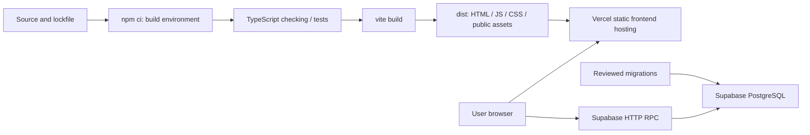

# Deployment: static frontend and a separate hosted database

The repository contains a Vercel SPA rewrite and Supabase SQL setup. That establishes the intended hosting integration, not the live state of a Vercel account, project domain, database, deployment history, or billing plan. No deployment was performed or production configuration inspected for this guide. Do not treat this application as production-ready solely because it builds.

## What gets deployed



The Node process on the build service executes tools. The resulting frontend runs in users' browsers. Supabase runs the data API/database. Neither Vite nor Vercel automatically applies the SQL files in this repository.

## The build, step by step

`npm run build` runs:

```text
tsc -b && vite build
```

TypeScript checks the referenced projects; app/tool configuration uses `noEmit`. If checking fails, `&&` prevents the Vite build from proceeding. Vite then transforms TSX/modules, replaces public environment constants, creates production JavaScript/CSS chunks, writes HTML, and copies public files into the output. The normal output directory is `dist/`; it is ignored by Git.

React lazy entry modules and dynamic tracing imports influence chunking. Assets in `public/` retain public paths, including `/assets/...`. Total repository asset size is not the first-load transfer size. Inspect generated files and browser Network timing rather than interpreting the 2000 kB warning threshold as a performance budget guarantee.

Read [Vite build guidance](https://vite.dev/guide/build) for the tool's general output model. This project is a client-rendered SPA, not a Next.js/SSR application.

## Prepare a candidate locally

Once setup succeeds:

```bash
npm ci
npm run typecheck
npm test
npm run build
npm run preview
```

Investigate failed/skipped/fixture-gated tests rather than claiming “all covered” from a green subset. Preview the built output and test `/`, `/studio`, `/u/type-a`, `/changes`, and an intentionally created development share. Check direct reloads, model/texture loads, keyboard controls, notes, finish choices, saving, and expected authorization failures. Physical headset behavior needs separate verification.

Record the commit, runtime, public configuration scope, migration state, actual checks, and unresolved problems. Do not put credential values into this record.

## Vercel integration

Use a Vercel project connected to the intended Git repository, with a preview environment before production. The following are **settings to verify/configure**, not inspected live settings:

| Setting | Repository-derived value or decision |
|---|---|
| Framework | Vite/client SPA. |
| Root directory | Repository root, where `package.json` resides. |
| Install command | `npm ci`, with build/dev dependencies available. |
| Build command | `npm run build`. |
| Output directory | `dist`. |
| Node runtime | Explicit compatible version; proposed Node 24.x baseline, not currently pinned in source. |
| Production branch | Verify the actual repository/team default; do not infer solely from examples. |
| Environment scope | Separate preview/development data from production where possible. |

Vercel can detect Vite projects, but confirm the resulting settings. The [official Vercel Vite guide](https://vercel.com/docs/frameworks/frontend/vite) covers platform integration. No Vercel CLI dependency is required for a dashboard/Git-connected workflow.

### Deep-link behavior

[vercel.json](../../vercel.json) contains:

```json
{
  "rewrites": [{ "source": "/((?!assets/|plans/).*)", "destination": "/index.html" }]
}
```

This allows a direct request for `/studio` or `/s/...` to receive the app document. It excludes the named static asset prefixes. The browser then interprets the pathname. Test exact platform behavior with real generated chunk/asset paths and unknown paths; a frontend wildcard is not an API authorization rule.

On another static host, decide an equivalent fallback and root-path asset strategy. Do not introduce a Node server merely because a deep link returned 404.

## Public environment settings and secret handling

The browser helper consumes `VITE_SUPABASE_URL` and `VITE_SUPABASE_PUBLISHABLE_KEY`. The config also reads `SUPABASE_URL` and `SUPABASE_KEY` from the build process and explicitly defines the corresponding browser constants if both aliases are set. That mapping is why an unprefixed alias is still public.

Choose one documented naming path per environment and avoid conflicting duplicate settings. All these specific Supabase URL/public-key values become visible in downloaded browser code. Keep them limited to the intended public application key. Secret/service-role keys and staff keys must never enter either public path. The alias guard recognizes some forbidden key formats but does not protect direct `VITE_` values; inspect the chosen key type yourself.

Build-time replacement means a dashboard variable edit does not rewrite an already deployed bundle. Build/redeploy and then inspect which project URL the browser actually requests. Environment scope mistakes can make a preview write to production. Follow [Vite's public-variable model](https://vite.dev/guide/env-and-mode) and [Supabase's key guidance](https://supabase.com/docs/guides/getting-started/api-keys).

Current staff UI stores its key in the browser and submits it to SQL; this is an existing limitation, not a server-side secret-management solution. Modern public-key header compatibility should also be verified for the current `rpc` helper before release.

## Supabase deployment and schema state

Provision an appropriate isolated database project first. Review and apply the share migration, then the events migration, with credentials/permissions suitable for schema administration. Do this as an intentional database operation, separately from a frontend push. The combined SQL-editor file is a convenience copy, not an independent third migration.

Before exposing real data, verify with the public API role that:

- Direct reads/writes of protected tables are denied.
- Valid token lookup returns only the expected snapshot; unknown/malformed tokens behave as intended.
- Wrong staff credentials fail; correct staff behavior is limited to the intended scope.
- Event constraints, retry idempotency, append-only enforcement, and report supersession behave in a real database.

Current SQL exposes global staff reporting and no organization isolation, expiry/revocation, rate limit, full JSON schema, or server-authoritative pricing workflow. Table RLS does not remove risks in privileged functions. These are release/design issues to resolve or explicitly accept based on the real deployment context, not hidden by this guide.

No tested backup/restore plan or migration rollback automation was found. For real operational data, establish backup/restore ownership and rehearse recovery before relying on it. Provider free-tier availability and quotas can change; product budget notes are not a permanent service guarantee.

## Logs, errors, and monitoring

| Failure | Where to look | Current limit |
|---|---|---|
| Dependency/TypeScript/bundle failure | Vercel build log or local npm terminal. | No committed CI workflow enforces independent checks automatically. |
| Blank page or UI exception | Browser Console, Debugger, Network. | No dedicated client error-reporting service installed. |
| Asset failure | Browser status/content type/path/timing; hosting deployment output. | Static hosting logs do not show client runtime state. |
| RPC/constraint/staff-key failure | Browser response plus Supabase API/database logs. | No custom application-server log stream. |
| Missing buyer history | Local outbox state, request status, hosted event/report data. | Browser-local failures can prevent a request; server logs alone cannot see that. |
| Slow interaction/rendering | Browser performance/GPU/Network traces. | No production performance-monitoring integration found. |

Protect credentials, share tokens, buyer names, drawing content, and request bodies when collecting diagnostics. A future monitoring service is a separate choice requiring configuration and data-handling decisions; it is not already present.

## Maintenance and recovery

Keep preview verification separate from production publishing. A deployment rollback can restore earlier frontend assets; it does not reverse applied SQL migrations, delete events, or restore browser-local work. Design schema changes for compatibility with both old and new clients during a transition.

Review dependency changes with the lockfile and relevant tests. `npm audit` queries advisory data and needs registry connectivity; it is not a complete application security audit, and `npm audit fix --force` is not a safe default maintenance step. Inspect public-asset provenance and sizes when adding models/textures. Recheck actual provider/API limits when changing usage.

The existing [fix roadmap](../../audit-reports/FIX_PRIORITY_ROADMAP.md), [security audit](../../audit-reports/SECURITY_AUDIT.md), and [issue tracker](../../audit-reports/ISSUE_TRACKER.md) provide prior findings to triage alongside fresh verification. They do not establish that this checkout is ready for production.

Next: [11 — Learning roadmap](11-LEARNING-ROADMAP.md).
